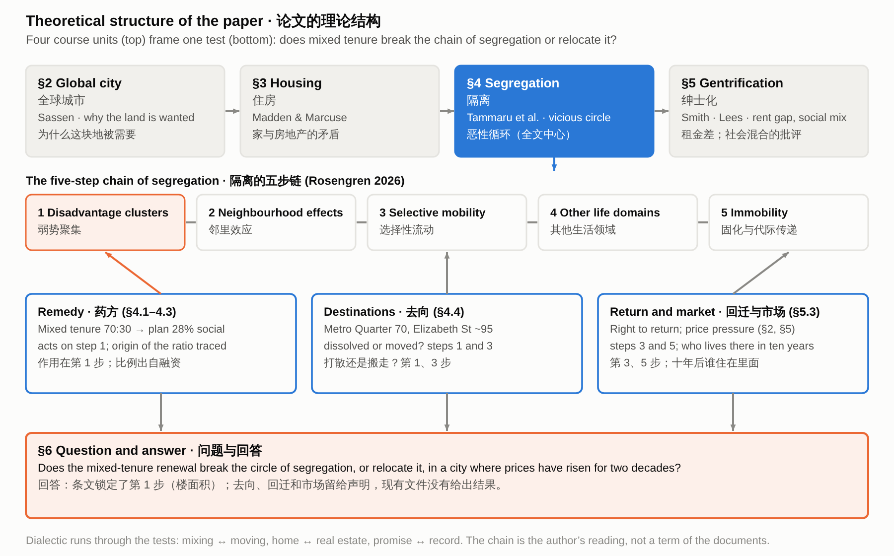

# 混合还是搬迁？隔离、绅士化与 Waterloo 公屋区的更新

> Waterloo 的混合租住更新，是打破了它本想解决的隔离恶性循环，还是把它搬到了别处？背景是一座房价已涨了二十年的城市。

## 目录

- 1. 引言
- 2. 全球城市：为什么 Waterloo 被卷进这场纠纷
  - 2.1 给案例定位：这块地为什么被需要
  - 2.2 给雄心以分量：价格
  - 2.3 触发点与官方诊断，转向第 4 节
- 3. 住房：策略，以及家与房地产的矛盾
  - 3.1 给出住房单元的对立，写 2015–2021 年的策略
  - 3.2 写策略怎样变：2022–2026
  - 3.3 用对立读这套策略
- 4. 隔离：用链条检验药方
  - 4.1 全文中心：链条与官方理由
  - 4.2 检验第 1 步
  - 4.3 药方从哪里来
  - 4.4 检验第 1、3 步：去向
  - 4.5 本文自己的角度：条文锁定了什么
  - 4.6 检验第 2–5 步
- 5. 绅士化：价格、代价与承诺
  - 5.1 定位绅士化单元：谁获益、谁承担
  - 5.2 社会混合的批评
  - 5.3 保护与缺口
- 6. 结论与讨论
  - 6.1 回答论文问题
  - 6.2 说明限度
  - 6.3 提出可检查的建议

## 1. 引言

**[1.1]** 公共住房的质量常被当作一个明摆着的事实来谈，但人们怎样理解它，其实随着为它制定的规划而变。Zanardo et al. (2024, 1207) 在研究悉尼 Waterloo 住宅区时开篇就提出一个论断：“澳大利亚公共住房的历史正在被更新项目改写。”在一个被规划为全球城市一部分的地区，一个地方被想象出来的未来，和施加在它身上的规划处理紧紧相连，因为一份规划既需要一个要被取代的过去，也需要一个要被交付的未来。

**[1.2]** Waterloo 约有 2,000 套住宅、占地 18 公顷，是悉尼最大的市区公共住宅区之一（Chatterjee et al. 2018），它的更新被描述为澳大利亚迄今提出的最大的住宅区更新计划（Zanardo et al. 2024, 1208）。自 2015 年州政府宣布以来，这份计划已经变动了好几次：规划路径在 2019 年从州主导改为市议会主导（Turner Studio & Turf 2020, PDF p. 6），2021 年又回到州政府手里（NSW Department of Planning and Environment 2022, PDF p. 11），2023 年全区社会住房与可负担住房的目标从 34% 提高到 50%（NSW Government 2023）。

**[1.3]** 它的声誉也一直在变，并且在政府和居民之间被争夺。Zanardo et al. (2024, 1208–1209) 记录了官员把这片住宅区称为“糟糕透顶”（Hazzard）、“不适合其用途”（Jackson）和“早就该更新了”（Hoenig）。住房部长 Rose Jackson 后来说，“成千上万套公屋集中在一个地方的老式住宅区”是“不具功能的社区”（Bowring 2026），这句话说的是那一类住宅区，不只是 Waterloo。居民的说法不一样。居民 Julie 说：“Waterloo 是我的家，我想留在这里”；住房活动者 Karyn Brown 回应部长时说：“它非常有功能”（Bowring 2026）。

**[1.4]** Zanardo et al. (2024, 1236) 和 Sisson (2024) 把这种模式描述为声誉差距(reputational gap)，Yrjänä (2026) 把这个词归到 Kallin 名下：一个地方的现在被贬低，它被想象出来的潜力被拿来与之对照，这让干预更容易得到辩护。Wynne and Rogers (2021) 则展示了居民在任何拆除发生之前，是怎样经历被迫搬迁的威胁的。

**[1.5]** 悉尼市议会这样描述这次更新所处的市场：“市区社区的绅士化加剧了能负担和不能负担住房的人之间的相对不平等”，并且“能负担私人市场住房的富裕家庭，与住在市区公共住宅区、社会经济上高度弱势的家庭之间，脱节越来越大”（City of Sydney n.d.）。官方更新这类住宅区的理由，回应的正是同一种分裂的一个版本：Future Directions 把弱势描述为在住宅区里聚集，并“代代相传”（NSW Government 2016, 24），混合租住(mixed tenure)是它的药方。本文要问的是，Waterloo 的更新是打破了这个循环，还是把它搬到了别处。它把计划的租住混合、被搬迁租户的去向和回迁的承诺，对照隔离恶性循环(vicious circle of segregation)的五个步骤（Rosengren 2026；Tammaru et al. 2021）来读，并问其中哪些由规划条文锁定、哪些只留给了声明，背景是一座城市，其中附属住宅(attached dwellings)的中位价格在 2006 到 2026 年间翻了一倍多（Australian Bureau of Statistics 2026）。各节按课程的四个单元展开：全球城市、住房、隔离和绅士化。

## 2. 全球城市：为什么 Waterloo 被卷进这场纠纷

**[2.1]** 课程的导论单元把悉尼的住房放进全球城市(global city)的框架里：这样的城市，竞争力建立在中心区的土地、基础设施和全球经济所需的服务之上（Sassen 1991）。州政府 2014 年的大都市战略遵循的正是这种逻辑。它界定了一条全球经济走廊，“贡献了 NSW 州内生产总值的 41% 以上”，并把 Green Square 列为战略中心，而战略文本里没有点名 Waterloo（NSW Planning and Environment 2014, 44）。这个单元还把城市空间看作各方对土地的主张相互争夺的场域(terrain)，Wynne (2018) 展示了这对 Waterloo 的租户意味着什么：他们生活在一套全球城市雄心的政策里，而这套政策触及了他们的家。我把土地读作城市的雄心与已经住在上面的人相遇的地方。这是把单元里的概念应用到悉尼，讲义并没有这样做。

**[2.2]** 价格给这种雄心带来了分量。悉尼附属住宅的中位转手价格，也就是 Waterloo 这类公寓所在的市场，从 2006 年 6 月的 39 万澳元涨到 2026 年 6 月的 84 万澳元，独立屋则从 49.5 万涨到 148.76 万澳元（Australian Bureau of Statistics 2026；图 1）。涨势已经停住。Cotality 的指数显示，到 2026 年 10 月为止的一年里悉尼房价下降了 9.4%，不过仍比十年前高 34.5%（Cotality 2026）。2026 年 6 月季度，邮编 2017（包含 Waterloo）的新租户每周租金中位数为 1,050 澳元，大悉尼为 780 澳元（NSW Department of Communities and Justice 2026）。图景并不一致：Waterloo 的普查中位租金 2016 年是 520 澳元，2021 年是 530 澳元，Zetland 则从 650 降到 600 澳元，不过两次普查并不完全可比（Australian Bureau of Statistics 2016a, 2016b, 2021a, 2021b）。

**[2.3]** 在这样的背景下，地铁站成了变化的触发点。Waterloo South 的城市设计研究称它为“这次更新的催化剂”（Turner Studio & Turf 2020, Part 1, PDF p. 6），规划建议书则论证说，保持现状会忽视新地铁站“潜在的催化效应”（NSW Land and Housing Corporation [LAHC] 2020, 92）。这片住宅区本身，是通过州政府对住宅区的一般性诊断来被解读的。Future Directions 认为，“许多住宅区存在高水平的犯罪、失业、家庭暴力、租赁管理问题、较差的教育结果和相关的儿童保护问题”（NSW Government 2016, PDF p. 24）。这个框架解释了为什么要这块土地，第 4 节要处理的诊断则解释了为什么上面的住房被认为需要替换。

## 3. 住房：策略，以及家与房地产的矛盾

**[3.1]** 住房单元问的是：住房是为了什么。它的核心对比，是住房作为生活的、社会性的空间，与住房作为盈利工具之间的冲突，也就是家与房地产(home and real estate)的冲突（Madden and Marcuse 2016）。Waterloo 的策略把两边都展示了出来。2015 年 12 月，州政府宣布这片住宅区将被拆除重建，约 30% 社会住房、70% 私人住房，出售私人住宅来为项目筹资（Zanardo et al. 2024, 1208），这与全州 70:30 的目标一致（NSW Government 2016, PDF p. 9）。州长说，没有人愿意租户“住在破旧的 1950 年代式住房里”（Gerathy 2015）。2019 年 11 月，规划路径从州主导改为市议会主导（Turner Studio & Turf 2020, Part 1, PDF p. 6），2021 年 3 月，州政府从市议会手里接过了规划主管机关的角色（NSW Department of Planning and Environment 2022, PDF p. 11）。规划建议书把现有房产描述为“处于经济寿命的终点”（LAHC 2020, 23），而同一项研究给出的平均房龄是 44 年，基准寿命是 60 年（Turner Studio & Turf 2020, Part 1, PDF p. 6）。

**[3.2]** 随后条件变了（图 2）。2022 年批准的计划提供 3,012 套住宅，其中 847 套是社会住房（NSW Department of Planning and Environment 2022, PDF p. 37）。2023 年 3 月政府更替之后，全区社会与可负担住房的比例从 34% 提高到 50%，租户获得回迁权的承诺，搬迁将分小批进行（NSW Government 2023）。2024 年，政府承诺至少提前六个月通知并提供专门支持，并重申所有居民都将获得回迁权（NSW Government 2024）。到 2026 年，新的概念申请提出约 3,300 套住宅，其中至少一半是社会住房或可负担住房（Scully 2026），首批约 150 套住宅的围栏开始搭建，预定在 6 月底前拆除（Bowring 2026）。Waterloo Metro Quarter 的 70 套社会住房已有人入住（NSW Government 2025）。对这片住宅区的描述并没有随着政府更替而变软。前一届政府的部长 Brad Hazzard 称它“糟糕透顶”，现任政府的部长 Rose Jackson 称它“不适合其用途”（Zanardo et al. 2024, 1208–1209）。

**[3.3]** 用这个单元来读，这套策略把这片住宅区放在了两边之间。在房地产一侧，规划建议书说，现有管制“考虑到拆除和建设的成本，不足以支持对整个场地进行可行的重新开发”（LAHC 2020, 92），一份早期提案只有在 30% 的住宅楼面面积用作社会住房、20% 用作可负担住房时，才提供额外的楼面面积（NSW Land and Housing Corporation 2021, Attachment A），出售私人住宅则负担了成本。在家的一侧，有回迁权，Waterloo South 的社会住房比现在多（Homes NSW 2026），以及新建社会与可负担住房中至少 15% 留给原住民（NSW Government 2023）。没有哪份官方文件用这样的话来说明资金模式。这种读法是对单元里那组对比的应用。

## 4. 隔离：用链条检验药方

**[4.1]** 隔离单元给出了课程对隔离如何自我再生产的说明。Tammaru et al. (2021) 把隔离的恶性循环(vicious circles of segregation)描述为不同生活领域里社会不平等与空间不平等相互关联的产物：优势滋生优势，弱势滋生弱势。讲义列出了五个步骤（图 3）：弱势在空间上聚集，邻里效应(neighbourhood effects)随之而来，不佳的观感影响谁会搬迁，隔离扩展到学校、工作等其他领域，最终成为贯穿整个生命历程、跨越代际的不能流动(immobility)（Rosengren 2026）。州政府更新住宅区的理由遵循的是同一条链。Future Directions 认为弱势集中在住宅区，说其影响“可以代代相传，强化弱势的循环”（NSW Government 2016, PDF p. 24），并提出私人住房与社会住房 70:30 的比例，“以形成更融合的社区”（NSW Government 2016, PDF p. 9）。

**[4.2]** 更新作用得最明显的是第一步。Waterloo South 现有 749 套社会住房和 120 套私人住房，社会住房约占 86%；获批的计划在 3,012 套中有 847 套社会住房，约 28%（NSW Department of Planning and Environment 2022, PDF pp. 8, 37；占比由这些数字计算；图 4）。这就是讲义所说的、让居住隔离变得不那么显眼的社会混合的稀释。城市设计研究用来说明密度的先例，在混合上说得更少。Green Square Town Centre 的表格显示 3,308 套住宅中有 104 套社会与可负担住房，约 3%，Waterloo 与 Zetland 合在一起的人口密度从每公顷 143 人升到 247 人（Turner Studio & Turf 2020, App. 6, 463–464）。这种比较有局限，因为这个镇中心只是 Green Square 的一部分，而市议会自己的目标是在其辖区内达到 7.5% 的社会住房和 7.5% 的可负担租赁住房（City of Sydney n.d.）。

**[4.3]** 悉尼的其他住宅区显示出这套条文是建立在什么上的。Khor et al. (2023, 77) 引 Darcy and Rogers (2019)，把 70:30 的比例追溯到郊区住宅区 Bonnyrigg，那里社会混合的结果“不是决策的决定因素”；Shrestha, Ruming and Rogers (2025) 发现，悉尼的住宅区更新模式经历了“从外围，经中环，走向核心”的移动。在 Sisson and Ruming (2025, 1825) 考察的场地上，场地内的社会住房套数减少，净增的住房属于私人租住。我把这读成：药方是用租住的数量来规定的，比例由融资条件而不是由结果决定，这是住房单元所讲的住房金融化(financialisation)的一个例子（Aalbers 2016）。这些住宅区的回迁人数和测得的邻里效应，不在这里用到的资料里。

**[4.4]** 被搬迁的家庭去哪里，决定了一个聚集是被打散了，还是被搬走了。现有租户已被安置到其他公共住房，其中至少 70 人搬进了 Waterloo 地铁站旁的新房（Bowring 2026）。政府点出了两个本区的去向：Metro Quarter 的 70 套社会住房，以及 Redfern 的 Elizabeth Street 约 95 套（Homes NSW 2026），2023 年它还把 Elizabeth Street 说成是让 Waterloo South 租户在本区安置的一种方式（NSW Government 2023；图 5）。这些是本区的去向。在 Bonnyrigg，一项追踪研究的第一轮发现，离开住宅区的家庭（访谈人数很少）安置到了公共住房不占多数的郊区环境里（Pinnegar, Liu and Randolph 2013），所以这个发现不能搬到 Waterloo 上来。文件没有给出 Waterloo 各去向的租户人数。可以说的是，第一步在一个场地上被稀释了，同时社会住房也被放到了附近。

**[4.5]** 规划条文锁定了药方的一部分，把另一部分留给了声明。计划定稿报告列出的 Waterloo South 专用控制，要求至少 26.5% 的住宅建筑面积是社会住房，至少 7.0% 是可负担住房，并要有不少于 5,000 平方米用于社区、健康和托育设施（NSW Department of Planning and Environment 2022, PDF p. 7）。这是楼面积的下限：它规定建多少社会住房，没有规定谁来住。设计指南里有租住和原住民住房的条款，但文件说在开发申请中只是要“被考虑”，“而不是把指南提升为开发标准”（PDF p. 7）。指南里最接近“人”的是这条原则：社会与可负担住房的提供，要使“形成一个社会多元、代表所有收入群体的居住人口”（Hassell 2022b, PDF p. 22），它没有提到回迁。回迁和搬迁则只以声明的形式出现。最终规划建议书记录说，土地与住房公司“已指出”现有居民有回迁权（Hassell 2022a, PDF p. 59）；部门在评估这次重新分区时，认为“适当的搬迁策略将会制定”这一回应是充分的（NSW Department of Planning and Environment 2022, PDF p. 14）。报告还提到，重大开发申请必须附社会影响评估（PDF p. 31），这是申请阶段的评估；两份文件都没有要求监测租户搬迁之后的情况。用链条的话说，这些控制触及第 1 步，并通过设施触及第 4 步的供给一侧，而涉及人往哪里去、之后怎样的第 3、5 步，靠的是规划文件之外的承诺。这是我对两份文件的读法，公报版 LEP 文本和后续批准条件没有核对。

**[4.6]** 后面几步依靠的证据没那么确定。Sisson (2024) 指出，“集中的弱势”背后的邻里效应概念“有争议地”把原因放在住宅区上。不确定性已经在作用于第三和第五步。Wynne and Rogers (2021) 认为，在任何搬迁发生之前，被驱逐的威胁就已经“对他们与地方的关系造成了重大伤害”；居民 Julie 说，她是醒来看到围栏在搭才知道要拆除，而她的搬迁被推迟了（Bowring 2026）。用链条来读，居民既不能选择也无法决定自己何时流动，等待本身就是循环的一部分。这是一种读法，文件并没有测量居民的流动或机会。

## 5. 绅士化：价格、代价与承诺

**[5.1]** 绅士化单元问的是：土地被重新投资时，谁获益，谁承担代价。Smith 的租金差(rent gap)是潜在地租与现有用途下被资本化的地租之间的差距（Smith 1979），Stein 则把绅士化描述为“由国家规划、由开发商生产、由公寓族消费”（Stein 2019, 41）。Zanardo et al. (2024) 把 Waterloo 与这样一个差距联系起来：国家实现的地租，与通过部分私有化和重新开发可能获得的地租之间的差距；Sisson (2024) 则说明，Communities Plus 计划挑选高价值地块，以便国家获得“物有所值”。悉尼市议会说，绅士化“加剧了能负担和不能负担住房的人之间的相对不平等”，并且市场正变得“对中低收入以下的人几乎无法进入”（City of Sydney n.d.）。对悉尼和墨尔本，Atkinson et al. (2011, 10) 发现，绅士化街区的迁出率比其他地方条件相当的家庭高出约 50%，不过他们的数据来自 2000 年代。

**[5.2]** 这个单元对社会混合的批评，与药方有关。Lees (2008) 认为，政策把绅士化当作通向更混合、更少隔离的社区的路径，而证据基础薄弱，她把社会混合描述为绅士化的一种正面包装。Yrjänä (2026) 展示了赫尔辛基的反隔离政策如何服务于国家主导的绅士化，其中的补贴差距(subsidy gap)是国家补上差额，以降低私人投资的风险。Hochstenbach (2017, 399) 发现，阿姆斯特丹推行社会混合的手段，从更新衰败的战后街区，转向了住房政策在推动绅士化的高需求街区，这与 Shrestha, Ruming and Rogers (2025) 在悉尼勾勒出的方向一致。Waterloo 的文件使用混合的语言，Homes NSW 说，“混合住房社区成功的一部分，在于社会住房与私人住房无法区分”（Homes NSW 2026）。规划文件还把 Green Square 作为建筑形态的先例（LAHC 2020, §5.1.7），而它的镇中心社会与可负担住房约占 3%（Turner Studio & Turf 2020, App. 6, 463）。在一个由市场主导的开发里，28% 的社会住房混合，是稀释了聚集，还是在为更高收入的居民准备这片地区，这是这个单元的问题。文件描述了意图，还没有显示结果。

**[5.3]** 自 2015 年以来，纸面上的保护增加了。包括回迁权、六个月通知、分阶段搬迁、更多社会住房，以及给原住民家庭的份额（NSW Government 2023, 2024；Homes NSW 2026）。其中回迁权、通知期和分阶段搬迁，不在计划定稿报告所列的专用控制里（NSW Department of Planning and Environment 2022, PDF p. 7）。被报道的缺口同样清楚。该计划用 847 套社会住房取代 749 套，只增加 98 套（NSW Department of Planning and Environment 2022, PDF pp. 8, 37；差值由计算得出），而按前一届政府对整个住宅区的计划，Sisson and Ruming (2025, 1839) 算出净增 148 套，增幅 7%。部长不能确认 20% 的可负担住房里有多少是永久的（Bowring 2026），活动人士说至少还有十个人住在场地上，而部长说剩下的人不是租户（Bowring 2026）。没有公布回迁租户的人数或时间。对绅士化单元来说，问题因此不在于新房会不会建成，而在于十年后谁住在里面、谁住在附近。文件承诺了回迁，还没有显示回迁。

## 6. 结论与讨论

**[6.1]** 更新通过稀释场地上的社会住房，改变了链条的第一步，而规划控制把这个变化锁定在楼面积上。它能不能打破这个循环，取决于条文沉默的地方：被搬迁的租户住在哪里，有多少人回迁，以及这片住宅区周围的市场会怎样。根据这里汇集的证据，更新把一部分租户安置到附近的其他社会住房，并承诺其余的人会回迁，而所处的市场里，绅士化已经拉大了住在私人住房的家庭和住在公共住宅区的家庭之间的差距（City of Sydney n.d.）。药方在悉尼二十年的住宅区更新里一路搬来（Shrestha, Ruming and Rogers 2025），到了核心，它的保证写在声明里，也没有找到结果测量。Zanardo et al. (2024) 和 Sisson (2024) 所描述的声誉差距，为它为什么被接受提供了一种解释。这种读法是我的，也是整个论证里检验得最少的部分。

**[6.2]** 这个论证有边界。它依据的是文件和已发表的研究，而不是访谈，所以居民的经验是通过别人的研究和个别新闻报道来呈现的。搬迁的去向有名称，但没有人数。价格序列在 2026 年转向，所以这里的主张涉及的是二十年的上涨，不是现在。五步链是读这个案例的一种方式，文件本身并不使用它。没有官方文件说明土地价值的资金模式，而 Waterloo 与 Zetland 的租金在 2016 与 2021 年两次普查之间并没有上涨。规划文件读的是规划门户上的版本，即计划定稿报告和最终规划建议书，所以“某项保护不在控制里”是对这两份文件的结论。

**[6.3]** 对规划有几点启示，每一点都可以对照文件来检验。规划条文现在按租住类型规定楼面积。它也可以要求报告这些楼面积所为之服务的人：多少租户回迁，什么时候，回到同一个地方还是只回到同一个区域，没有回迁的人住在哪里。社会住房的占比应当与社会住房的数量一起公布，因为数量在上升而占比在下降。可负担住房是否永久应当得到确认。在现有建筑可以翻新的地方，应当考虑保留（Zanardo et al. 2024）。这些建议并不需要以政策出于恶意为前提。它们只要求把这个药方对它想要帮助的人所造成的代价计算进去。

