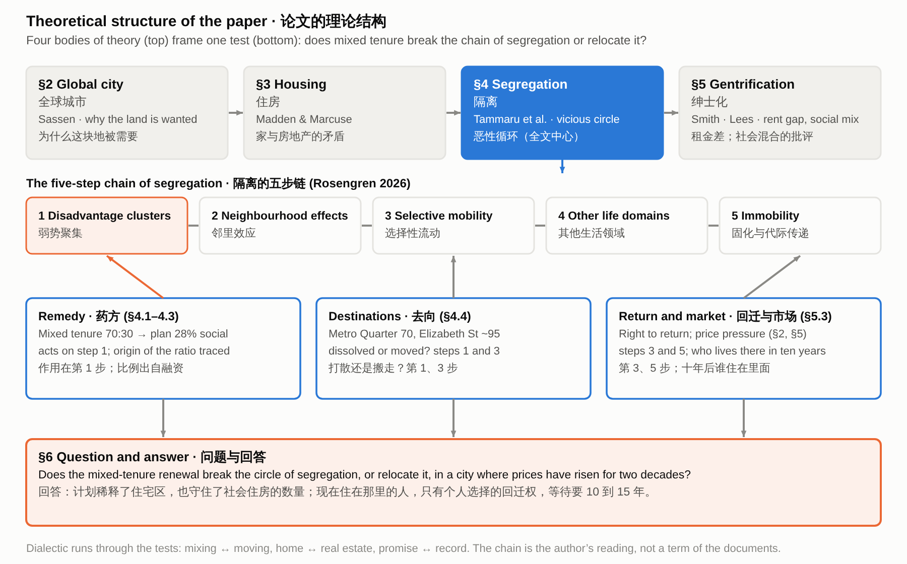

# 论文草稿 v2：每一段的结构说明

> Waterloo 的混合租住更新，是打破了它本想解决的隔离恶性循环，还是把它搬到了别处？背景是一座房价已涨了二十年的城市。

## 目录

- 1. 引言
- 2. 全球城市：为什么 Waterloo 被卷进这场纠纷
  - 2.1 给案例定位：这块地为什么被需要
  - 2.2 给雄心以分量：价格
  - 2.3 触发点与官方诊断，转向第 4 节
- 3. 住房：策略，以及家与房地产的矛盾
  - 3.1 给出住房单元的对立，写 2015–2021 年的策略
  - 3.2 写策略怎样变：2022–2026
  - 3.3 用对立读这套策略
- 4. 隔离：用链条检验药方
  - 4.1 全文中心：链条与官方理由
  - 4.2 检验第 1 步
  - 4.2b 住的是什么人
  - 4.2c 周边已被市场混合
  - 4.2d 悉尼全区的尺度
  - 4.2e 混合不是尺子
  - 4.3 药方从哪里来
  - 4.4 检验第 1、3 步：去向
  - 4.5 规则保证了什么
  - 4.6 回迁和搬迁只是声明
  - 4.6b 别处的回迁
  - 4.7 检验第 2–5 步
- 5. 绅士化：价格、代价与承诺
  - 5.1 类型与阶段
  - 5.2 社会混合的批评
  - 5.3 直接置换与时间
  - 5.3b 另外三种置换
  - 5.3c 排他性置换
  - 5.3d 置换压力
  - 5.4 成本与收益
- 6. 结论与讨论
  - 6.1 回答论文问题
  - 6.2 说明限度
  - 6.3 讨论：案例对各框架的意义
  - 6.4 说明局限
  - 6.5 提出可检查的建议

## 辩证的部分与实在的部分

- **A 家 ↔ 房地产（Home ↔ real estate）**：住房作为生活空间，与住房作为盈利工具之间的冲突（Madden and Marcuse 2016）。 见 ¶3.1, 3.3, 5.1。3.3 为两边各列证据（可行性成本、早期容积奖励 ↔ 回迁权、更多社会住房），5.1 用租金差说明谁获益。作为并列的张力保留，不宣布哪一边赢。
- **B 混合 ↔ 搬走（Mixing ↔ moving）**：同一个措施，在一个场地上稀释聚集，在另一些场地上可能只是把聚集放到别处。这是核心问题。 见 ¶4.2, 4.3, 4.4, 6.1。4.2 给稀释的数字（86%→28%），4.4 给去向的名称，4.3 说明 Bonnyrigg 的去向不能照搬；6.1 的回答取决于去向、回迁和市场这三件文件没回答的事。
- **C 诊断 ↔ 证据（Diagnosis ↔ evidence）**：官方把住宅区的弱势读成代代相传的循环，药方是混合租住；但药方的比例出自融资条件，邻里效应也有争议。 见 ¶2.3, 4.1, 4.3, 4.7。2.3、4.1 摆出诊断；4.3 追溯 70:30 的出处；4.5 引 Sisson 与 Zanardo 说明证据并不确定。
- **D 承诺 ↔ 记录（Promise ↔ record）**：2023 年以来保护增多（回迁权、通知期），但回迁人数、永久性和时间没有公布。 见 ¶3.2, 5.3, 6.2, 6.3。3.2、5.3 分别写承诺与缺口；6.3 把缺口变成可以对照文件检查的建议。
- **E 想象的未来 ↔ 居民的经验（Imagined future ↔ lived experience）**：现在被贬低、未来被理想化（声誉差距），而居民经历的是在地失所与等待。 见 ¶1.3, 1.4, 3.2, 4.7, 6.1。作为支线：1.3–1.4 引出，3.2 显示负面描述跨两届政府连续，4.5 写居民的等待，6.1 承认这是检验得最少的部分。
- **F 写进规则 ↔ 只是承诺（Written into rules ↔ only promised）**：规划文件用最低楼面积保证了混合租住；回迁、通知和搬迁只是承诺。这是本文自己的角度。 见 ¶4.5–4.6, 5.3, 6.1, 6.3。4.5 逐条分层：专用控制、设计指南、声明；5.3 说明保护不在控制里；6.3 建议把对楼面积做的事也对人做。

### 实在的锚点

| 项目 | 内容 | 出处 | 位置 |
|---|---|---|---|
| 价格压力 | 悉尼附属住宅中位转手价 $390,000 → $840,000（2006→2026） | ABS 2026 | ¶2.2 |
| 规划控制 | 社会住房 ≥26.5%、可负担 ≥7.0% 的住宅建筑面积；社区/健康/托育 ≥5,000 平方米 | DPE 2022, PDF p. 7 | ¶4.5 |
| 回迁与搬迁的位置 | LAHC “has noted” 回迁权；“appropriate relocation strategies will be developed” | Hassell 2022a, PDF p. 59；DPE 2022, PDF p. 14 | ¶4.6 |
| 占比 | 社会住房 86% → 28%（749/869 → 847/3,012） | DPE 2022, PDF pp. 8, 37；占比由计算得出 | ¶4.2 |
| 先例 | Green Square Town Centre 104/3,308，约 3% | Turner Studio & Turf 2020, App. 6, 463 | ¶4.2, 5.2 |
| 药方的出处 | 70:30 追溯到 Bonnyrigg；Bonnyrigg 833 套 / 2,330 套 | Khor 等 2023, 77；Benedict 等 2022 | ¶4.3 |
| 净增 | 749→847（+98）；前政府计划整个住宅区 +148、7% | DPE 2022；Sisson and Ruming 2025, 1839 | ¶5.3 |
| 去向 | Metro Quarter 70 套 + Elizabeth St 约 95 套；各去向人数未公布 | Homes NSW 2026 | ¶4.4 |
| 官方诊断 | 弱势“可代代相传” | NSW Government 2016, PDF p. 24 | ¶2.3, 4.1 |
| 保护 | 回迁权、六个月通知、分阶段搬迁 | NSW Government 2023, 2024 | ¶3.2, 5.3 |

## 1. Introduction

> 本节：引言；提出问题与路线；课程四单元的预告

### ¶1.1

Mixing tenures is a standard remedy for the concentration of disadvantage in public housing estates. The NSW Government justified renewing its estates with a diagnosis, that disadvantage clusters in estates and is “passed on through multiple generations” (NSW Government 2016, PDF p. 24), and with a remedy, a 70:30 split between private and social dwellings “to enable more integrated communities” (NSW Government 2016, PDF p. 9). This paper asks whether the renewal of the Waterloo estate in Sydney breaks that circle of segregation or only moves it. It reads the renewal as state-led gentrification of a public housing estate and asks, for each of Marcuse’s four forms of displacement, what evidence from 2019 to 2026 exists at Waterloo South. The evidence is strongest for protection against exclusion, since the number of social homes rises, and weakest for the people who live there now: return is an individual choice for existing tenants, and it cannot yet be observed.

> 作用：题目与论点：诊断、药方、问题和答案  
> 辩证：打破循环 ↔ 搬到别处  
> 实在：Future Directions pp. 24、9  

### ¶1.2

Waterloo, with about 2,000 dwellings on 18 hectares, is among Sydney's largest inner-city public housing estates (Chatterjee et al. 2018), and its renewal has been described as the largest estate renewal proposed in Australia to date (Zanardo et al. 2024, 1208).

> 作用：交代案例与时间线  
> 辩证：规模与历史 ↔ 目标反复改变  
> 实在：约 2,000 套、18 公顷；2015 年起路径与比例的变化  

### ¶1.3

The renewal takes place in an expensive market: the median price of attached dwellings in Sydney more than doubled between 2006 and 2026 (Australian Bureau of Statistics 2026), and the sale of private dwellings funds the renewal (Zanardo et al. 2024, 1208).

> 作用：市场背景  
> 辩证：市场的论证 ↔ 公屋区的现状  
> 实在：City of Sydney 对市场的描述；ABS 价格；Zanardo 1208  

### ¶1.4

Existing work on Waterloo concerns reputation and displacement. Zanardo et al. (2024, 1236) and Sisson (2024) describe a reputational gap, a term Yrjänä (2026) attributes to Kallin, in which the present of a place is devalued and its imagined potential is set against it, and Wynne and Rogers (2021) show how residents experience the threat of displacement before any demolition. This paper takes reputation as background and reads the plan as gentrification, against the five steps of the vicious circle of segregation and the four forms of displacement.

> 作用：已有研究与本文的位置  
> 辩证：现在被贬低 ↔ 未来被理想化；官员 ↔ 居民  
> 实在：Zanardo、Sisson、Yrjänä、Wynne and Rogers、Bowring 2026  

### ¶1.5

The paper is a document analysis. Its materials are the planning documents for Waterloo South (the plan finalisation report, the final planning proposal and the Design Guide, all from 2022) and for the concept application of 2025–26 (the proponent’s scoping report, the issued assessment requirements, the exhibition notice and appendices A–E of the impact statement), government statements and media releases from 2015 to 2026, news reports, the 2020 social baseline report and census figures for Waterloo, and published studies of Waterloo and of estates elsewhere in Australia and the United States. Each protection for tenants is sorted by where it appears: in a binding planning control, in the Design Guide, in a statement inside the planning record, or only in an announcement.

> 作用：路线  
> 辩证：写进规则 ↔ 只是承诺  
> 实在：五步链；四组理论  

### ¶1.6

The argument has three steps. First, the estate is a pocket of low-income, older and lone-person households inside an area the market has already mixed, and Sydney’s concentrations of disadvantage lie elsewhere (section 4). Second, the renewal is state-led, new-build gentrification, and Marcuse’s four forms of displacement give a way to sort what is known (section 5). Third, the evidence from 2019 to 2026 is collected for each form (Table 2), and it protects the number of social homes better than it protects the people (section 6). The sections take four bodies of urban theory in turn: the global city, housing, segregation and gentrification.

> 作用：路线  
> 辩证：条文锁定 ↔ 声明  
> 实在：五步链；四个课程单元  

## 2. The global city: why Waterloo is drawn into the dispute

> 本节：§2 全球城市；背景节：这块地为什么被需要（不下结论）；导论单元：Sassen；斗争场域

### ¶2.1

The strategy that frames Sydney as a global city does not name Waterloo. The state’s 2014 metropolitan strategy defines a Global Economic Corridor that “generates over 41 per cent of the NSW Gross State Product” and lists Green Square among its strategic centres, in line with the global-city idea that a city’s competitiveness rests on central land, infrastructure and the services of a global economy (Sassen 1991; NSW Planning and Environment 2014, 44).

> 作用：给案例定位：这块地为什么被需要  
> 辩证：城市的雄心 ↔ 已经住在这里的人  
> 实在：2014 年大都市战略；Wynne 2018  
> 课件：课件：导论单元。概念：Sassen 的全球城市；斗争场域（讲义里 Brenner & Schmid 的说法）。展开：用 2014 年规划把概念落到悉尼，说明为什么这片土地被需要；最后一句标明“土地成为雄心与居民相遇的地方”是应用，不是讲义的话。证据：规划文本、Wynne (2018)。

### ¶2.2

The renewal is paid for by selling new private flats, and the price of those flats has risen strongly. The median transfer price of attached dwellings in Sydney rose from $390,000 in June 2006 to $840,000 in June 2026 (Australian Bureau of Statistics 2026; Figure 1).

> 作用：给雄心以分量：价格  
> 辩证：上涨 ↔ 2026 年回调与局部租金没涨  
> 实在：ABS、Cotality、DCJ、普查租金  
> 课件：课件：导论单元，也为绅士化单元的租金差做铺垫。展开：用价格数据说明土地为什么值钱；同时写出 2026 年回调和 2016–2021 年的反例，不写成“现在还在涨”。注意：邮编 2017 对应 Waterloo 是常识，文件没有写明，需核对。证据：ABS、Cotality、DCJ、普查。

### ¶2.3

What brought the pressure to Waterloo was a metro station, which the urban design study calls “the catalyst for the renewal” (Turner Studio & Turf 2020, Part 1, PDF p. 6) and the planning proposal cites for its “potential catalytic effects” (NSW Land and Housing Corporation [LAHC] 2020, 92). The reason given for replacing the housing is a different one. Future Directions, a statewide strategy, says that “many estates experience high levels of crime, unemployment…” (NSW Government 2016, PDF p. 24). This describes estates in general, not Waterloo, and section 4 tests it.

> 作用：触发点与官方诊断，转向第 4 节  
> 辩证：催化剂（土地）↔ 诊断（房子）  
> 实在：规划建议书、城市设计研究、Future Directions  
> 课件：课件：导论单元收尾，转向隔离单元。展开：地铁站是触发点；官方对住宅区的诊断是后面第 4 节要检验的对象。证据：规划建议书、城市设计研究、Future Directions（全州文件，不是 Waterloo 专属）。

## 3. Housing: the strategy, and the conflict between home and real estate

> 本节：§3 住房；描述节：策略怎样变，两种住房观的张力；住房单元：Madden and Marcuse；家 vs 房地产

### ¶3.1

The plan has treated Waterloo both as people’s homes and as a way to pay for new housing. In December 2015 the state announced that the estate would be demolished and rebuilt with about 30 per cent social and 70 per cent private housing, the sale of the private dwellings funding the project (Zanardo et al. 2024, 1208), in line with a statewide target of 70:30 (NSW Government 2016, PDF p. 9). The planning proposal says the existing properties are “at the end of their economic life” (LAHC 2020, 23), yet the same study gives their average age as 44 years against a benchmark life of 60 (Turner Studio & Turf 2020, Part 1, PDF p. 6). Madden and Marcuse (2016) call this tension a conflict between home and real estate: housing as lived, social space against housing as an instrument for profit-making.

> 作用：给出住房单元的对立，写 2015–2021 年的策略  
> 辩证：家 ↔ 房地产  
> 实在：2015 年宣布约 30:70；2019、2021 年路径变化；44 年对 60 年  
> 课件：课件：住房单元。概念：Madden & Marcuse 的家与房地产。展开：先给出讲义的对立，再按时间写 2015–2021 年策略怎样变，并列出官方对房子的描述（Baird、经济寿命）。注意“44 年对 60 年”并排出现，文件没有解释。证据：Zanardo 等、Future Directions、规划文件。

### ¶3.2

The promises to tenants grew after 2023, but the planning rules were written before them (Figure 2). The plan approved in 2022 provides 3,012 dwellings, of which 847 are social housing, and its planning controls date from November 2022 (NSW Department of Planning and Environment 2022, PDF p. 37). After a change of government in March 2023, the share of social and affordable housing across the estate was raised from 34 to 50 per cent, tenants were promised the right to return, and relocation was to proceed in small stages (NSW Government 2023); in 2024 it added at least six months’ notice and dedicated support (NSW Government 2024). So the promises moved ahead of the rules. The floor-area part has since reached the planning documents: the proponent’s 2025 scoping report describes 50 per cent of residential floor area as committed to social and affordable housing (Beam Planning 2025, PDF pp. 4, 20), and the 2026 concept application proposes at least 30 per cent of residential floor area as social housing and no more than 50 per cent as market housing (NSW Department of Planning, Housing and Infrastructure 2026). None of the three documents for this stage mentions a right of return.

> 作用：写策略怎样变：2022–2026  
> 辩证：条件在变 ↔ 负面描述连续  
> 实在：847/3,012；34%→50%；Hazzard 与 Jackson 的话  
> 课件：课件：住房单元（政策与策略的变化）。展开：2022–2026 年条件在变（比例、回迁、通知），而对住宅区的负面描述跨两届政府连续。证据：规划部报告、新闻稿、Zanardo 等转引。这里显示的是承诺和提案，不是结果。

### ¶3.3

The strategy can be sorted into measures that protect the money and measures that protect the tenants’ homes. On the money side, the planning proposal says that the existing planning rules “would not be capable of supporting a feasible redevelopment of the entire site given the costs of demolition and construction” (LAHC 2020, 92), and the sale of private dwellings carries the cost. On the tenants’ side are the right to return and more social homes in Waterloo South than there are now (Homes NSW 2026a). No official document sorts the strategy in this way. Sections 4 and 5 ask which side the binding rules protect.

> 作用：用对立读这套策略  
> 辩证：商品一边 ↔ 使用一边  
> 实在：可行性成本、早期容积奖励；回迁权、更多社会住房  
> 课件：课件：住房单元（家 vs 房地产）。展开：商品一边和使用一边各举证据，最后一句说明这是对讲义对立的应用，没有官方文件直接说明土地价值资助模型。

## 4. Segregation: testing the remedy against the chain

> 本节：§4 隔离；中心节：把药方放在五步链上检验；隔离单元：Tammaru 等；Rosengren

### ¶4.1

The state’s case for renewal rests on an argument that segregation research also makes: disadvantage that clusters in one place reproduces itself. Tammaru et al. (2021) describe vicious circles of segregation as the product of connected social and spatial inequalities in different life domains: advantage breeds advantage and disadvantage breeds disadvantage. Five steps can be distinguished (Figure 3): disadvantage clusters spatially, neighbourhood effects follow, poor perceptions shape who moves, segregation spreads to other domains such as schools and work, and it becomes immobility across the life course and across generations (Rosengren 2026). Future Directions follows the same chain: it finds disadvantage concentrated in estates and proposes mixed tenure as the remedy (NSW Government 2016, PDF pp. 9, 24).

> 作用：全文中心：链条与官方理由  
> 辩证：诊断（代代相传）↔ 药方（混合租住）  
> 实在：Tammaru 等、Rosengren；Future Directions 第 9、24 页  
> 课件：课件：隔离单元。概念：Tammaru 等的恶性循环；Rosengren 的五步链。展开：先写讲义里的链，再指出官方的更新理由就是这条链，药方是混合租住。这是全文的中心，后面四段按步骤检验。

### ¶4.2

On step 1 the plan works: social housing falls from 86 per cent of the site’s dwellings to 28 per cent. Waterloo South now has 749 social and 120 private dwellings, and the plan approved in 2022 has 847 social dwellings among 3,012 (NSW Department of Planning and Environment 2022, PDF pp. 8, 37; shares calculated from these figures; Figure 4). Homes NSW now gives about 1,050 social homes among about 3,300 (Homes NSW 2026a), about 32 per cent. This is dilution by social mixing, which makes concentrated disadvantage less visible. The same plan can also be described as growth, 749 social dwellings becoming about 1,050, so a document can call it dilution or growth depending on whether it counts share or number.

> 作用：检验第 1 步  
> 辩证：聚集 ↔ 稀释  
> 实在：社会住房 86%→28%；Green Square Town Centre 约 3%  
> 课件：课件：隔离单元第 1 步（弱势聚集），及讲义里“被小尺度社会混合稀释”的说法。展开：用计划数字写占比 86%→28%（占比是算术），再用 Green Square 先例的 3% 说明混合的程度。限定：3% 是一个镇中心；表格来自扫描件，需对照原页。

### ¶4.2b

Who lives on the site shapes what step 1 dilutes. In February 2026, 607 tenant households with 836 residents remained on Waterloo South: 77 per cent were single-person households, 62 per cent had a tenant over 55 (or over 45 for Aboriginal tenants), and 19 per cent of tenants were Aboriginal (Homes NSW 2026b, PDF p. 7). In September 2019 their households had an average income of $525 a week, 73 per cent lived alone and 33 per cent drew their main income from a disability pension (GHD 2020, PDF pp. 30, 34). The poverty line for a single adult in 2019–20 was $489 a week (Davidson, Bradbury and Wong 2023, PDF p. 8), so the average household was near it. Nationally 25 per cent of public housing households receive a disability pension (Porter et al. 2023, 21). Its neighbourhoods ranked in the two lowest deciles of disadvantage in the state (GHD 2020, PDF p. 30). The concentration is therefore one of low income, age, disability and living alone. Steps 4 and 5 of the chain concern schools, work and the next generation, and 149 of the 995 tenants in July 2025 were under 18 (Homes NSW 2025a, PDF p. 19).

> 作用：住的是什么人  
> 辩证：集中的是年龄与残疾 ↔ 链条的后几步面向工作年龄和儿童  
> 实在：GHD 2020：$525/周、68%、73%、33%；单亲 35%  
> 课件：社会基线报告（GHD 2020）：749 套、$525/周、68% 户主 50 岁以上、73% 独居、33% 靠残疾抚恤金；2016 普查：原住民 9%/3%/1%，单亲家庭 35%/15%/10%，SEIFA 最低两个十分位。分析：集中的主要是年龄、残疾和独居；第 4、5 步涉及的学校、工作和下一代，至多影响不到三分之一的住户。

### ¶4.2c

The area around the estate has already been mixed by the market. The social baseline report says that the surroundings “have undergone significant redevelopment in recent years”, which “changed local demographics, with more tertiary students, … professionals, young families, couples without children” (GHD 2020, PDF p. 3). Ten of the 15 neighbourhood units of Waterloo East rank in the top three deciles of advantage, though three rank in the lowest, and the suburb as a whole ranks in the second decile (PDF pp. 37, 75).

> 作用：周边已被市场混合  
> 辩证：市场在周围混合 ↔ 计划在场地上混合  
> 实在：GHD 2020 pp. 3、30、31、35；ABS 2021  
> 课件：GHD 2020：周边已被市场混合（学生、专业人士、年轻家庭）；Waterloo East 多为第八十分位以上；预期更新会吸引相似人群。郊区周收入中位数 $1,503→$2,028（名义 +35%），不等于住宅区。

### ¶4.2d

The chain also runs at the scale of the whole city, and the remedy acts on the estate. In Greater Sydney the large social-housing estates that dominate a disadvantaged suburb lie mainly in the western suburbs: of 177 disadvantaged suburbs in Sydney, Melbourne and Brisbane, 14 are dominated by social housing and 13 of those are in Sydney (Hulse et al. 2014, PDF pp. 16, 40). Waterloo is not one of them. The same study had to set aside Waterloo and Haymarket as statistical outliers, Waterloo for “rapid gentrification” (PDF p. 38). The latest metropolitan study finds Sydney’s segregation rising because very-high-income households cluster in the least disadvantaged areas “rather than” because very-low-income households cluster (Sarkar et al. 2024, PDF p. 34). The state’s metropolitan plan lists “areas of high social housing concentration where there is good access to services, transport and jobs” as candidates for renewal (Greater Sydney Commission 2018, PDF p. 61), which points renewal at well-served locations such as Waterloo’s. Renewing Waterloo can therefore reduce concentration on the estate without changing the metropolitan pattern.

> 作用：悉尼全区的尺度  
> 辩证：住宅区尺度的药方 ↔ 大都会尺度的格局  
> 实在：Hulse 等 2014；Sarkar 等 2024；GSC 2018；Pawson 等 2015；Morris 2017  
> 课件：悉尼全区的尺度：Hulse 等 2014（14/177 以社会住房为主，13 在悉尼，在西部；Waterloo 是“快速绅士化”的异常值）；Sarkar 等 2024（悉尼隔离由富裕端集中驱动）；大都会规划（GSC 2018）；“尺度错配”；Morris 2017。

### ¶4.2e

Taken together, these facts change what step 1 achieves. The estate is a pocket of low-income, older and disabled households inside a neighbourhood the market has already mixed, and Sydney’s concentrations of disadvantage lie elsewhere. Adding private housing to the estate mixes at the scale of the block what the neighbourhood already mixes at the scale of the street, so the mix cannot be the measure of success. What the estate’s residents stand to keep or lose is their place, and the test that the chain implies is retention: whether the households now there remain.

> 作用：混合不是尺子  
> 辩证：口袋 ↔ 已混合的邻里  
> 实在：GHD 2020；Hulse 等；Sarkar 等  
> 课件：论点转折：混合不是成功的尺子，留住才是；依据 4.2b–4.2d

### ¶4.3

The 70:30 remedy was not designed from evidence about what mixing achieves. Khor et al. (2023, 77), citing Darcy and Rogers (2019), trace the ratio to Bonnyrigg, a suburban estate, where social-mixing outcomes “was not a determinant of decision-making”. None of these sources counts returning tenants or measures neighbourhood effects. That outcomes were not a determinant fits the financialisation of housing (Aalbers 2016), and the rules then enforce a quantity of tenure and not an outcome.

> 作用：药方从哪里来  
> 辩证：药方的出处 ↔ 效果证据  
> 实在：AHURI 412；Shrestha 等；Sisson and Ruming  
> 课件：课件：隔离单元（药方从哪里来）。展开：70:30 来自融资而不是效果证据，药方从郊区搬到核心，因此条文是用数量写的。证据：AHURI 412、Shrestha 等的摘要、Sisson & Ruming。限定：“用数量规定”是我的读法；没有回迁人数和邻里效应的测量。

### ¶4.4

Where displaced tenants go decides whether the cluster is dissolved or only moved. By November 2025 about 60 tenants of Stage 1 had been relocated, “either to a home in the local area or to another area of their choice in NSW” (Homes NSW 2025b, PDF p. 3), and in mid-2026 the ABC reported that at least 70 current tenants had moved into the new homes beside the Waterloo metro station (Bowring 2026). Homes NSW names two local destinations, the 70 social homes at the Metro Quarter and about 95 more at Elizabeth Street, Redfern (Homes NSW 2026a). The counts differ in date and source, and no document gives the number of tenants at each destination.

> 作用：检验第 1、3 步：去向  
> 辩证：打散 ↔ 搬走  
> 实在：Metro Quarter 70 套、Elizabeth St 约 95 套；Bonnyrigg 小样本  
> 课件：课件：隔离单元第 1 步和第 3 步（谁移动、移到哪里）。展开：被搬走的人去了其他社会住房，是把聚集搬了地方的证据。限定：只有去向的名称，没有各去向的人数，所以只能写“可以说的是……”。

### ¶4.5

The planning rules guarantee how much social housing is built, but not who lives in it and not whether tenants can come back. The site-specific controls that the plan finalisation report lists for Waterloo South require no less than 26.5 per cent of residential floor area as social housing, no less than 7.0 per cent as affordable housing, and at least 5,000 square metres for community, health and childcare facilities (NSW Department of Planning and Environment 2022, PDF p. 7). These are minimum amounts of floor area. Such minimums fix which kinds of housing the new buildings contain, not which households hold them. The Design Guide, where the tenure and Aboriginal housing provisions sit, is only to be considered in development applications “but not to elevate the guidance within the design guide to development standards” (PDF p. 7).

> 作用：规则保证了什么  
> 辩证：保证（楼面积下限）↔ 没保证（谁来住）  
> 实在：DPE 2022, PDF p. 7；设计指南 PDF p. 22  
> 课件：课件：隔离单元（五步链）+ 住房单元（住房阶级）。展开：规划规则保证了什么：楼面积下限，但不管谁来住。证据：计划定稿报告 PDF p. 7；设计指南 PDF p. 22。

### ¶4.6

Return and relocation appear as guidance and statements, not as planning controls. The final planning proposal records that the Land and Housing Corporation “has noted” that current residents have a right of return (Hassell 2022a, PDF p. 59), and the department accepted a response that “appropriate relocation strategies will be developed” (NSW Department of Planning and Environment 2022, PDF p. 14). Neither document requires anyone to track what happens to tenants after they move. The strategy has since been written down in Homes NSW’s support guide of February 2026, which gives existing tenants a right to return that “will be an individual choice for each tenant” (Homes NSW 2026b, PDF p. 16). The guide is not a planning control and sets no deadline for return. The body of the environmental impact statement, the social impact assessment (its Appendix EE) and the gazetted rules are outside this reading (section 6.4). In terms of the five steps, the rules reach step 1; steps 3 and 5, which concern where people go and what happens to them, depend on guidance and promises (Table 1).

> 作用：回迁和搬迁只是声明  
> 辩证：规则 ↔ 声明  
> 实在：Hassell 2022a, PDF p. 59；DPE 2022, PDF pp. 14, 31；2025 评估小组报告  
> 课件：课件：隔离单元（五步链）+ 绅士化单元（国家主导的政策手段）。展开：回迁和搬迁只以声明出现，规则也可能改变。证据：最终规划建议书 PDF p. 59；报告 PDF pp. 14、31；2025 年评估小组报告。限定：只核对了 2022 年的文件；2025 年报告是看图读的。

### ¶4.6b

Where return has been counted elsewhere, it has been low. About 40 per cent of residents came back to Carlton in Melbourne, after being moved first to other estates or to dwellings elsewhere, and 20 per cent to Kensington (Porter et al. 2023, 30, citing Levin et al. 2018 and Shaw et al. 2013). In Chicago, fewer than 11 per cent of the 16,846 relocated family households lived in the new mixed-income developments at the end of 2010 (Joseph and Chaskin 2012, 378), and the average return rate at four HOPE VI sites was 5 per cent (Comey 2007, cited in Joseph and Chaskin 2012, 379). Goetz (2010) ties low return to the years between displacement and completion. Bonnyrigg in Sydney is the closest model, since staged building let tenants move within the estate, and Porter et al. (2023, 30) expect Waterloo to follow it. These are other cities and other programmes, and none gives a Waterloo figure.

> 作用：别处的回迁  
> 辩证：回迁率 ↔ 承诺  
> 实在：Porter 等 2023；Joseph & Chaskin 2012；Goetz 2010；Pinnegar 等 2013  
> 课件：别处统计过的回迁率：Carlton 约 40%、Kensington 20%（Porter 等 2023, 30）；芝加哥 <11%、HOPE VI 四个点平均 5%（Joseph & Chaskin 2012）；Goetz 2010；Bonnyrigg 分阶段在地搬迁，社会住房少约 200 套，Waterloo 749→847。

### ¶4.7

Steps 2 to 5 are where the evidence is thinnest. Sisson (2024) notes that the concept of neighbourhood effects behind “concentrated disadvantage” “controversially” places the cause in the estate. Reviews offer limited evidence on steps 2 to 5: a systematic review of 27 UK studies found some positive effects of mixed tenure in the social and residential domains but none on social capital (Sautkina, Bond and Kearns 2012), and Manley, van Ham and Doherty (2011) conclude that the evidence base for social mixing is “far from robust”. Uncertainty already acts on steps three and five. Wynne and Rogers (2021) argue that the threat of eviction “has already done significant damage to their relationship to place” before any move. No document measures residents’ mobility or opportunities.

> 作用：检验第 2–5 步  
> 辩证：已知（等待）↔ 未知（接触、服务、学校、就业的结果）  
> 实在：Sisson、Hirvonen and Lilius、Wynne and Rogers、Bowring 2026  
> 课件：课件：隔离单元第 2–5 步；并连到在地失所（Wynne & Rogers）。展开：邻里效应有争议；不确定性作用于第 3、5 步。限定：这是读法，没有测量。

## 5. Gentrification: price, cost and promise

> 本节：§5 绅士化；代价节：价格压力、谁承担、承诺与记录；绅士化单元：Smith；Lees；Stein；Yrjänä

### ¶5.1

The renewal is a case of state-led, new-build gentrification. Davidson and Lees (2005, 1170) give four defining elements: reinvestment of capital, social upgrading of the locale by incoming high-income groups, landscape change, and direct or indirect displacement of low-income groups. The first three are present at Waterloo. The sale of private dwellings reinvests capital in public land and closes Smith’s (1979) rent gap, between potential and actual ground rent, through the state itself; the landlord’s consultants expect the renewal to attract “a similar demographic” to Waterloo East (GHD 2020, PDF p. 31); and the buildings are replaced. The fourth is the question of this section. Hackworth and Smith (2001, 468–469) describe a third wave in which the state is “more involved in the process” and large developers orchestrate reinvestment. The surrounding area has been rebuilt, so the estate is renewed late in the process, not at its start. No published author places Waterloo on a named stage, so this placement is the paper’s own, and it rests on the features listed.

> 作用：类型与阶段  
> 辩证：国家主导＋新建；后段  
> 实在：Davidson and Lees 2005；Hackworth and Smith 2001；Hulse 等 2014  
> 课件：课件：绅士化单元。概念：Smith 租金差；Stein 的国家主导（引自讲义）。展开：把价格背景连到“谁获得收益”，并用 City of Sydney 自己的文件和 AHURI 2011 说明代价。限定：AHURI 数据早于更新。

### ¶5.2

Mixing is the policy that this remedy shares with “positive gentrification”, and the evidence for it is weak. Lees (2008) finds a “poor evidence base” for that policy, which is promoted in the belief that it will reduce segregation. Yrjänä (2026) shows in Helsinki how an anti-segregation policy can serve state-led gentrification, and Hochstenbach (2017) finds for Amsterdam that the instruments of social mixing moved to high-demand neighbourhoods, the direction that Shrestha, Ruming and Rogers (2025) trace in Sydney. Davidson (2008, 2402) puts the question that mixing leaves open: “how many people should be displaced—lose their home and neighbourhood—before it becomes a problem?” There are two routes to better conditions for the people on the estate: upgrade the buildings for them where they are, or sell part of the land to richer residents to pay for new ones. The documents take the second. The market share, which pays for the rest, fell from 66.5 per cent of residential floor area in the 2022 proposal to at most 50 per cent in the 2026 concept (Hassell 2022a, PDF p. 19; NSW Department of Planning, Housing and Infrastructure 2026).

> 作用：社会混合的批评  
> 辩证：混合的话语 ↔ 绅士化的话语  
> 实在：Lees、Yrjänä、Hochstenbach；Homes NSW 的 “indistinguishable”；Green Square 约 3%  
> 课件：课件：绅士化单元。概念：Lees 对社会混合的批评；Yrjänä 的国家主导绅士化。展开：用文献的论点读 Waterloo 的“混合”；Green Square 先例出现在这里（支线）。限定：这是文献的论点用来读案例，不是发现。

### ¶5.3

Marcuse (1985, 205–208) separates four forms of displacement and says that all four must be counted. The rest of this section asks what evidence from 2019 to 2026 exists for each at Waterloo South (Table 2). Direct displacement is the landlord moving its own tenants. Notices went to 145 Stage 1 tenants in February 2025 (Homes NSW 2025c, PDF p. 2), and about 60 had been relocated by November 2025, “either to a home in the local area or to another area of their choice in NSW” (Homes NSW 2025b, PDF p. 3). The safeguards are written down: at least six months’ notice, up to two offers of housing, check-ins soon after a move and about three and six months later, and a right for existing tenants to return (Homes NSW 2026b, PDF pp. 14, 16). What is missing is the outcome. No document counts where tenants went, and return cannot be counted until the first new buildings are finished; where it has been counted elsewhere it has been low (section 4). The process itself is also disputed: activists said that at least ten people were still living in the fenced block, and the minister said the remaining people were not tenants (Bowring 2026).

> 作用：直接置换与时间  
> 辩证：个人选择 ↔ 等待的年数  
> 实在：Homes NSW 2026b、d；ABS 生命表；Price and Popkin 2010；Porter 等 2023  
> 课件：课件：绅士化单元（置换：直接与间接）。展开：纸面上的保护多于 2015 年；记录到的缺口；回迁没有数据。限定：新闻里的说法要写成“据报道”；增加 98 套是计算差；间接置换在这两个片区没有找到研究。

### ¶5.3b

Chain displacement counts households that leave before the last resident is moved. Relocation runs in phases over 10 to 15 years, and the high-rise buildings of Waterloo North and Central are to stay for at least another ten (Homes NSW 2026c, PDF p. 2), so the estate empties slowly. The count was 995 tenants in July 2025 (Homes NSW 2025a, PDF p. 19) and 836 residents in 607 households in February 2026 (Homes NSW 2026b, PDF p. 7), but the two figures use different labels, and no document says how many tenants left before they were notified. Wynne and Rogers (2021) argue that the threat of eviction changes residents’ relationship to place before any move. The evidence for this form is thin.

> 作用：另外三种置换  
> 辩证：数量受保护 ↔ 压力无保护  
> 实在：Beam Planning 2026 App. E；Atkinson 等 2011；Homes NSW 2025b  
> 课件：四种置换中另外三种：连锁、排他性、压力；排他性保护最好，压力没有保护

### ¶5.3c

Exclusionary displacement keeps similar households from moving in, and it is where the evidence of protection is strongest. The number of social homes rises from 749 to about 1,050 (Homes NSW 2026a). At least 7 per cent of residential floor area is to be affordable housing held in perpetuity by a community housing provider, other affordable housing is to be kept for at least 25 years, and 20 per cent of the social housing floor area is to be prioritised for First Nations tenants, all of which the applicant expects to be imposed as consent conditions (Beam Planning 2026, App. E, PDF p. 6). The share of social housing nonetheless falls from 86 to about 32 per cent, and the documents examined do not say how the additional homes will be allocated.

> 作用：排他性置换  
> 辩证：数量受保护 ↔ 占比下降、分配规则未见  
> 实在：Homes NSW 2026a；Beam Planning 2026 App. E  
> 课件：排他性置换：数量上升，永久／25 年，优先原住民；占比下降；分配规则未见

### ¶5.3d

Displacement pressure is the strain of watching the neighbourhood change around you. The area around the estate has already been rebuilt (section 4), the suburb’s median household income rose about 35 per cent between 2016 and 2021 (GHD 2020, PDF p. 35; Australian Bureau of Statistics 2021), and the landlord’s consultants expect the renewal to attract “a similar demographic” to Waterloo East (GHD 2020, PDF p. 31). Hulse et al. (2014, PDF p. 38) name Waterloo an outlier for “rapid gentrification”, and Atkinson et al. (2011, PDF p. 10) found that in gentrified parts of Sydney and Melbourne public renters moved out at a higher rate than expected, a change they link to “estate remodelling and demolitions”. Davidson (2008, 2391–2392) adds that social housing tenants “may be insulated from some indirect displacement pressures” but not from changes in community and neighbourhood services. These show that the area has changed. None measures what the change did to tenants, and none of the planning documents examined addresses it.

> 作用：置换压力  
> 辩证：地区变化 ↔ 对租户的影响  
> 实在：GHD 2020；ABS 2021；Hulse 等；Atkinson 等 2011；Davidson 2008  
> 课件：置换压力：地区变化有证据；对租户的影响未测量；无规划文件处理

### ¶5.4

Marcuse (1984–85, 933–934) observes that the costs and benefits of gentrification fall on different classes, and that public resources invested in a neighbourhood “will not help existing lower-income residents without specific provisions designed to achieve that end”. At Waterloo the cost of the move falls on low-income tenants, and the benefits go to the buyers of the new flats, to the state that sells the land, and to the further social homes that the sales pay for. Freeman (2005) finds that gentrifying neighbourhoods in New York could change without much displacement, but his data do not isolate a landlord relocating its own tenants for a rebuild. Counting the four forms, the evidence shows protection of the number of social homes and process without outcome for the people now living there. The question is therefore not whether the new buildings will exist but whether the people who live there now will be among those who live in them, and the documents promise return without showing it.

> 作用：成本与收益  
> 辩证：承担者 ≠ 获益者  
> 实在：Marcuse 1984–85；Freeman 2005  
> 课件：谁承担成本、谁获益；四种置换汇总；回应 Freeman

## 6. Conclusion and discussion

> 本节：§6 结论；回答与限度；回收四个单元

### ¶6.1

The approved plan dilutes the estate, and the evidence from 2019 to 2026 protects the number of social homes better than the people who live there. Social housing falls from 86 to 28 per cent of the dwellings on the site in the 2022 plan, and binding minimum floor areas guarantee that step 1 of the chain is addressed. Counting Marcuse’s four forms of displacement, the evidence is strongest for exclusionary displacement, where the number of social homes rises from 749 to about 1,050. It records a process without an outcome for direct displacement, is thin for chain displacement, and describes the area but not the tenants for displacement pressure (Table 2). Return cannot yet be observed, and where it has been counted elsewhere between 5 and about 40 per cent of tenants came back. In a neighbourhood the market has already mixed, and in a metropolis where disadvantage lies elsewhere, adding richer neighbours does not by itself break the circle at Waterloo. Whether it is broken or only moved is decided by who is still there when the buildings are finished, and the evidence available in 2026 cannot say.

> 作用：回答论文问题  
> 辩证：打破 ↔ 搬走：取决于条文沉默的地方  
> 实在：前面各节的汇总；Shrestha 等  
> 课件：课件：回收四个理论。展开：回答问题——更新在场地上做到了混合，规划规则也只保证了混合；能否打破循环，规则没有答案。

### ¶6.2

This paper adds three small things to existing work on Waterloo. First, it reads the renewal as state-led, new-build gentrification and collects the evidence for each of Marcuse’s four forms of displacement (Table 2). Four studies of Waterloo (Zanardo et al. 2024; Sisson 2024; Wynne and Rogers 2021; Sisson and Ruming 2025) deal with reputation, land value, displacement and housing supply, and none uses the vocabulary of segregation or sorts the evidence by all four forms. Second, it sorts each protection for tenants by where it sits (Table 1) and finds that the rules guarantee floor area while return and relocation are guidance and statements. Third, it separates the share from the number of social homes, and sets the estate against its neighbourhood and against the Sydney-wide pattern of disadvantage.

> 作用：说明限度  
> 辩证：已有 ↔ 缺失  
> 实在：无访谈；去向无人数；价格转向；链条是读法  
> 课件：课件：论文的贡献（讨论部分）。展开：三点：用隔离链读 Waterloo（已有四篇研究的文本里“segregat-”出现 0 次，已核对）；把保护措施按所在层次分类（表 1）；区分占比与套数、两条置换通道。限定：是对文件的发现，没有检验租户的结果。

### ¶6.3

The case supports some frameworks and limits others. It is consistent with the view of Stein and Davidson that the state plans and justifies large-scale redevelopment (Davidson 2018, 249), and it extends the global-city account: the pressure reached Waterloo through a metro station, not through the corridor strategy. It limits two accounts. In Yrjänä’s (2026) Helsinki the state pays a subsidy gap to de-risk private investment, while in the Waterloo documents the money runs the other way, with private sales paying for social homes. And accounts of home against real estate (Madden and Marcuse 2016), or of mixing against segregation, treat the two sides as opposed, while Waterloo’s policy kept changing: the share of social and affordable housing rose from 34 to 50 per cent in 2023 (NSW Government 2023), and the right to return was added.

> 作用：讨论：案例对各框架的意义  
> 辩证：赞同／拓展 ↔ 限定  
> 实在：Davidson 2018, 249；Yrjänä 2026；NSW Government 2023；2025 评估小组报告  
> 课件：课件：讨论部分。展开：案例赞同、拓展、限定了谁的框架（Stein、Davidson、Sassen、Yrjänä、Madden and Marcuse）。限定：一个案例只能显示机制，不能检验理论；详见伴读报告。

### ¶6.4

This argument has limits. It rests on documents and published studies, not on interviews, so residents’ experience comes through other researchers and single news reports. Return cannot yet be observed, because the first new buildings are not finished, so the paper collects evidence on safeguards and process and not on outcomes. The body of the environmental impact statement, the social impact assessment, the gazetted rules and the Homes NSW relocation policy beyond its guides were not read (of the impact statement only appendices A to E were), so “not among the rules” means only that a measure is not in the documents examined. Shrestha, Ruming and Rogers (2025) and Hochstenbach (2017) are known here from their abstracts. Destinations are named but not counted, and the figures on return come from other cities, where tenure, programme and period differ. The documents do not use the five-step chain or Marcuse’s four forms; they are the frames applied to them, and no study applying the chain to Sydney, or following inner-city tenants’ destinations across the metropolitan area, was found. The placement of Waterloo as late-stage, state-led, new-build gentrification is the paper’s own. The conclusion therefore holds for the documents examined and may change when the exhibited proposal is read in full.

> 作用：说明局限  
> 辩证：已有 ↔ 缺失  
> 实在：无访谈；只读 2022 年文件；去向无人数；部分文献只读摘要  
> 课件：课件：局限（讨论部分）。展开：无访谈；只读 2022 年的文件，2026 年提案、公报版规则、搬迁政策没读；两篇文献只读摘要；去向无人数；价格是全市数字；五步链是我的读法。

### ¶6.5

Planning could do for people what it already does for floor space. The rules fix floor space by tenure; they could also require reporting on how many tenants return, when, and to the same place or only the same area, and where those who do not return live. The share of social housing should be published beside the number of social homes, and the rules for allocating the additional homes should be published. The permanence of the affordable homes beyond the first 7 per cent, which the applicant says will be held in perpetuity, should be confirmed. Where the existing buildings can be renovated, retention should be considered (Zanardo et al. 2024). None of this assumes bad faith. It asks that the cost of the remedy to the people it is meant to help be counted.

> 作用：提出可检查的建议  
> 辩证：楼面积 ↔ 人：把对楼面积做的事也对人做  
> 实在：回迁、去向、占比、永久性、翻新  
> 课件：课件：讨论部分，连回四个单元：回迁与去向（隔离、绅士化单元）、占比（隔离单元）、保留与翻新（住房单元）。核心建议：把条文已经为楼面积做的事，也为人做一遍——报告回迁和去向。

