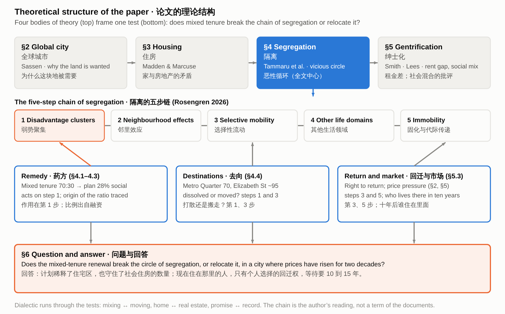

# Mixing or Moving? Segregation, Gentrification and the Renewal of the Waterloo Estate

> Does the mixed-tenure renewal of Waterloo break the vicious circle of segregation it is meant to address, or relocate it, in a city where housing prices have risen for two decades?

## Contents

- 1. Introduction
- 2. The global city: why Waterloo is drawn into the dispute
  - 2.1 
  - 2.2 
  - 2.3 
- 3. Housing: the strategy, and the conflict between home and real estate
  - 3.1 
  - 3.2 
  - 3.3 
- 4. Segregation: testing the remedy against the chain
  - 4.1 
  - 4.2 
  - 4.2b 
  - 4.2c 
  - 4.2d 
  - 4.2e 
  - 4.3 
  - 4.4 
  - 4.5 
  - 4.6 
  - 4.6b 
  - 4.7 
- 5. Gentrification: price, cost and promise
  - 5.1 
  - 5.2 
  - 5.3 
  - 5.3b 
  - 5.4 
- 6. Conclusion and discussion
  - 6.1 
  - 6.2 
  - 6.3 
  - 6.4 
  - 6.5 

*Figure 0. Theoretical structure: four bodies of theory frame one test of the chain of segregation.*

## 1. Introduction

Mixing tenures is a standard remedy for the concentration of disadvantage in public housing estates. The NSW Government justified renewing its estates with a diagnosis, that disadvantage clusters in estates and is “passed on through multiple generations” (NSW Government 2016, PDF p. 24), and with a remedy, a 70:30 split between private and social dwellings “to enable more integrated communities” (NSW Government 2016, PDF p. 9). This paper asks whether the renewal of the Waterloo estate in Sydney breaks that circle of segregation or only moves it, and argues that it is best read as state-led gentrification of a public housing estate. The planning documents guard the number of social homes, which rises, but not the people who live in them now, most of whom live alone, many of them older, on low incomes: return is an individual choice open to existing tenants, and the rebuild takes 10 to 15 years.

Waterloo, with about 2,000 dwellings on 18 hectares, is among Sydney's largest inner-city public housing estates (Chatterjee et al. 2018), and its renewal has been described as the largest estate renewal proposed in Australia to date (Zanardo et al. 2024, 1208). The plan has changed several times since the state government announced it in 2015.

The renewal takes place in an expensive market: the median price of attached dwellings in Sydney more than doubled between 2006 and 2026 (Australian Bureau of Statistics 2026), and the sale of private dwellings funds the renewal (Zanardo et al. 2024, 1208).

Existing work on Waterloo concerns reputation and displacement. Zanardo et al. (2024, 1236) and Sisson (2024) describe a reputational gap, a term Yrjänä (2026) attributes to Kallin, in which the present of a place is devalued and its imagined potential is set against it, and Wynne and Rogers (2021) show how residents experience the threat of displacement before any demolition. This paper takes reputation as background and reads the plan as gentrification, against the five steps of the vicious circle of segregation and the four forms of displacement.

The paper is a document analysis. Its materials are the planning documents for Waterloo South (the plan finalisation report, the final planning proposal and the Design Guide, all from 2022) and for the concept application of 2025–26 (the proponent’s scoping report, the issued assessment requirements, the exhibition notice and appendices A–E of the impact statement), government statements and media releases from 2015 to 2026, news reports, the 2020 social baseline report and census figures for Waterloo, and published studies of Waterloo and of estates elsewhere in Australia and the United States. Each protection for tenants is sorted by where it appears: in a binding planning control, in the Design Guide, in a statement inside the planning record, or only in an announcement.

The argument has three steps. First, the renewal acts on a pocket: the estate is a low-income group of older, disabled and lone-person households inside an area the market has already mixed, and Sydney’s concentrations of disadvantage lie elsewhere (section 4). Second, it is state-led, new-build gentrification, and Marcuse’s four forms of displacement show where the plan guards tenants and where it does not (section 5). Third, the guards are strongest for the number of social homes and weakest for the people, because return is open to existing tenants only and the wait is long (sections 5 and 6). The sections take four bodies of urban theory in turn: the global city, housing, segregation and gentrification.

## 2. The global city: why Waterloo is drawn into the dispute

The strategy that frames Sydney as a global city does not name Waterloo. The state’s 2014 metropolitan strategy defines a Global Economic Corridor that “generates over 41 per cent of the NSW Gross State Product” and lists Green Square among its strategic centres, in line with the global-city idea that a city’s competitiveness rests on central land, infrastructure and the services of a global economy (Sassen 1991; NSW Planning and Environment 2014, 44). So the question for the renewal is what happens to the people already living on the land.

The renewal is paid for by selling new private flats, and the price of those flats has risen strongly. The median transfer price of attached dwellings in Sydney rose from $390,000 in June 2006 to $840,000 in June 2026 (Australian Bureau of Statistics 2026; Figure 1). The documents examined give no price or rent figures for the Waterloo site itself.

What brought the pressure to Waterloo was a metro station, which the urban design study calls “the catalyst for the renewal” (Turner Studio & Turf 2020, Part 1, PDF p. 6) and the planning proposal cites for its “potential catalytic effects” (NSW Land and Housing Corporation [LAHC] 2020, 92). The reason given for replacing the housing is a different one. Future Directions, a statewide strategy, says that “many estates experience high levels of crime, unemployment…” (NSW Government 2016, PDF p. 24). This describes estates in general, not Waterloo, and section 4 tests it.

## 3. Housing: the strategy, and the conflict between home and real estate

The plan has treated Waterloo both as people’s homes and as a way to pay for new housing. In December 2015 the state announced that the estate would be demolished and rebuilt with about 30 per cent social and 70 per cent private housing, the sale of the private dwellings funding the project (Zanardo et al. 2024, 1208), in line with a statewide target of 70:30 (NSW Government 2016, PDF p. 9). The planning proposal says the existing properties are “at the end of their economic life” (LAHC 2020, 23), yet the same study gives their average age as 44 years against a benchmark life of 60 (Turner Studio & Turf 2020, Part 1, PDF p. 6). Madden and Marcuse (2016) call this tension a conflict between home and real estate: housing as lived, social space against housing as an instrument for profit-making.

The promises to tenants grew after 2023, but the planning rules were written before them (Figure 2). The plan approved in 2022 provides 3,012 dwellings, of which 847 are social housing, and its planning controls date from November 2022 (NSW Department of Planning and Environment 2022, PDF p. 37). After a change of government in March 2023, the share of social and affordable housing across the estate was raised from 34 to 50 per cent, tenants were promised the right to return, and relocation was to proceed in small stages (NSW Government 2023); in 2024 it added at least six months’ notice and dedicated support (NSW Government 2024). By 2026 a new concept application proposed about 3,300 homes, at least half of them social or affordable (Scully 2026). So the promises moved ahead of the rules. The floor-area part has since reached the planning documents: the proponent’s 2025 scoping report describes 50 per cent of residential floor area as committed to social and affordable housing (Beam Planning 2025, PDF pp. 4, 20), and the 2026 concept application proposes at least 30 per cent of residential floor area as social housing and no more than 50 per cent as market housing (NSW Department of Planning, Housing and Infrastructure 2026). None of the three documents for this stage mentions a right of return.

The strategy can be sorted into measures that protect the money and measures that protect the tenants’ homes. On the money side, the planning proposal says that the existing planning rules “would not be capable of supporting a feasible redevelopment of the entire site given the costs of demolition and construction” (LAHC 2020, 92), and the sale of private dwellings carries the cost. On the tenants’ side are the right to return and more social homes in Waterloo South than there are now (Homes NSW 2026a). No official document sorts the strategy in this way. Sections 4 and 5 ask which side the binding rules protect.

## 4. Segregation: testing the remedy against the chain

The state’s case for renewal rests on an argument that segregation research also makes: disadvantage that clusters in one place reproduces itself. Tammaru et al. (2021) describe vicious circles of segregation as the product of connected social and spatial inequalities in different life domains: advantage breeds advantage and disadvantage breeds disadvantage. Five steps can be distinguished (Figure 3): disadvantage clusters spatially, neighbourhood effects follow, poor perceptions shape who moves, segregation spreads to other domains such as schools and work, and it becomes immobility across the life course and across generations (Rosengren 2026). Future Directions follows the same chain. It finds disadvantage concentrated in estates, says that its effects “can be passed on through multiple generations, reinforcing the cycle of disadvantage” (NSW Government 2016, PDF p. 24), and proposes mixed tenure, with a 70:30 split between private and social dwellings “to enable more integrated communities” (PDF p. 9).

On step 1 the plan works: social housing falls from 86 per cent of the site’s dwellings to 28 per cent. Waterloo South now has 749 social and 120 private dwellings, and the plan approved in 2022 has 847 social dwellings among 3,012 (NSW Department of Planning and Environment 2022, PDF pp. 8, 37; shares calculated from these figures; Figure 4). Homes NSW now gives about 1,050 social homes among about 3,300 (Homes NSW 2026a), about 32 per cent. This is dilution by social mixing, which makes concentrated disadvantage less visible. The same plan can also be described as growth, 749 social dwellings becoming about 1,050, so a document can call it dilution or growth depending on whether it counts share or number.

Who lives on the site shapes what step 1 dilutes. In February 2026, 607 tenant households with 836 residents remained on Waterloo South: 77 per cent were single-person households, 62 per cent had a tenant over 55 (or over 45 for Aboriginal tenants), and 19 per cent of tenants were Aboriginal (Homes NSW 2026b, PDF p. 7). In September 2019 their households had an average income of $525 a week, 73 per cent lived alone and 33 per cent drew their main income from a disability pension (GHD 2020, PDF pp. 30, 34). The poverty line for a single adult in 2019–20 was $489 a week (Davidson, Bradbury and Wong 2023, PDF p. 8), so the average household was near it. Nationally 25 per cent of public housing households receive a disability pension (Porter et al. 2023, 21), so Waterloo is higher but not different in kind. Its neighbourhoods ranked in the two lowest deciles of disadvantage in the state (GHD 2020, PDF p. 30). The concentration is therefore one of low income, age, disability and living alone. Steps 4 and 5 of the chain concern schools, work and the next generation, and 149 of the 995 tenants in July 2025 were under 18 (Homes NSW 2025a, PDF p. 19).

The area around the estate has already been mixed by the market. The social baseline report says that the surroundings “have undergone significant redevelopment in recent years”, which “changed local demographics, with more tertiary students, … professionals, young families, couples without children” (GHD 2020, PDF p. 3). Ten of the 15 neighbourhood units of Waterloo East rank in the top three deciles of advantage, though three rank in the lowest, and the suburb as a whole ranks in the second decile (PDF pp. 37, 75). The report expects the renewal of Waterloo South to be “highly likely to attract a similar demographic” (PDF p. 31). The median household income of the suburb rose from $1,503 a week in the 2016 census to $2,028 in 2021, a nominal rise of about 35 per cent (GHD 2020, PDF p. 35; Australian Bureau of Statistics 2021). That figure covers private households as well as tenants and does not describe the estate.

The chain also runs at the scale of the whole city, and the remedy acts on the estate. In Greater Sydney the large social-housing estates that dominate a disadvantaged suburb lie mainly in the western suburbs: of 177 disadvantaged suburbs in Sydney, Melbourne and Brisbane, 14 are dominated by social housing and 13 of those are in Sydney (Hulse et al. 2014, PDF pp. 16, 40). Waterloo is not one of them. The same study had to set aside Waterloo and Haymarket as statistical outliers, Waterloo for “rapid gentrification” (PDF p. 38). The latest metropolitan study finds Sydney’s segregation rising because very-high-income households cluster in the least disadvantaged areas “rather than” because very-low-income households cluster (Sarkar et al. 2024, PDF p. 34). The state’s metropolitan plan lists “areas of high social housing concentration where there is good access to services, transport and jobs” as candidates for renewal (Greater Sydney Commission 2018, PDF p. 61), which points renewal at well-served locations such as Waterloo’s. Pawson, Hulse and Cheshire (2015, PDF p. 12) call the use of local solutions for systemic causes a “scalar mismatch”. Renewing Waterloo can therefore reduce concentration on the estate without changing the metropolitan pattern. No study that was found follows where inner-city tenants go across Sydney; the one statement available, for Millers Point, is that most were settled within 10 km of the city centre (Morris 2017, PDF p. 7).

Taken together, these facts change what step 1 achieves. The estate is a pocket of low-income, older and disabled households inside a neighbourhood the market has already mixed, and Sydney’s concentrations of disadvantage lie elsewhere. Adding private housing to the estate mixes at the scale of the block what the neighbourhood already mixes at the scale of the street, so the mix cannot be the measure of success. What the estate’s residents stand to keep or lose is their place, and the test that the chain implies is retention: whether the households now there remain.

The 70:30 remedy was not designed from evidence about what mixing achieves. Khor et al. (2023, 77), citing Darcy and Rogers (2019), trace the ratio to Bonnyrigg, a suburban estate, where social-mixing outcomes “was not a determinant of decision-making”. None of these sources counts returning tenants or measures neighbourhood effects. That outcomes were not a determinant fits the financialisation of housing (Aalbers 2016), in which housing is treated as an asset, and the rules then enforce a quantity of tenure and not an outcome.

Where displaced tenants go decides whether the cluster is dissolved or only moved. By November 2025 about 60 tenants of Stage 1 had been relocated, “either to a home in the local area or to another area of their choice in NSW” (Homes NSW 2025b, PDF p. 3), and in mid-2026 the ABC reported that at least 70 current tenants had moved into the new homes beside the Waterloo metro station (Bowring 2026). Homes NSW names two local destinations, the 70 social homes at the Metro Quarter and about 95 more at Elizabeth Street, Redfern (Homes NSW 2026a). The counts differ in date and source, and no document gives the number of tenants at each destination. What can be said is that the plan dilutes social housing on the site while also placing social housing nearby.

The planning rules guarantee how much social housing is built, but not who lives in it and not whether tenants can come back. The site-specific controls that the plan finalisation report lists for Waterloo South require no less than 26.5 per cent of residential floor area as social housing, no less than 7.0 per cent as affordable housing, and at least 5,000 square metres for community, health and childcare facilities (NSW Department of Planning and Environment 2022, PDF p. 7). These are minimum amounts of floor area. Such minimums fix which kinds of housing the new buildings contain, not which households hold them. The Design Guide, where the tenure and Aboriginal housing provisions sit, is only to be considered in development applications “but not to elevate the guidance within the design guide to development standards” (PDF p. 7).

Return and relocation appear as guidance and statements, not as planning controls. The final planning proposal records that the Land and Housing Corporation “has noted” that current residents have a right of return (Hassell 2022a, PDF p. 59), and the department accepted a response that “appropriate relocation strategies will be developed” (NSW Department of Planning and Environment 2022, PDF p. 14). Neither document requires anyone to track what happens to tenants after they move. The strategy has since been written down. The support guide of February 2026 gives tenants at least six months’ notice and up to two offers of housing, check-ins soon after a move and about three and six months later, and the right for “all existing Waterloo tenants at the time of relocations” to return once new buildings are complete, which “will be an individual choice for each tenant” (Homes NSW 2026b, PDF pp. 14, 16). The guide is not a planning control and sets no deadline for return, and none of the four Homes NSW relocation documents says what happens to the right if a tenant dies or enters aged care before the buildings are finished. The body of the impact statement, the social impact assessment (its Appendix EE) and the gazetted rules are outside this reading (section 6.4). In terms of the five steps, the rules reach step 1; steps 3 and 5, which concern where people go and what happens to them, depend on guidance and promises (Table 1).

Where return has been counted elsewhere, it has been low. About 40 per cent of residents came back to Carlton in Melbourne, after being moved first to other estates or to dwellings elsewhere, and 20 per cent to Kensington (Porter et al. 2023, 30, citing Levin et al. 2018 and Shaw et al. 2013). In Chicago, fewer than 11 per cent of the 16,846 relocated family households lived in the new mixed-income developments at the end of 2010 (Joseph and Chaskin 2012, 378), and the average return rate at four HOPE VI sites was 5 per cent (Comey 2007, cited in Joseph and Chaskin 2012, 379). Goetz (2010) ties low return to the years between displacement and completion. Bonnyrigg in Sydney is the closest model, since staged building let tenants move within the estate, and Porter et al. (2023, 30) expect Waterloo to follow it. Bonnyrigg still lost about 200 social dwellings (Porter et al. 2023, 30), whereas the Waterloo South plan raises the number from 749 to about 1,050. These are other cities and other programmes, and none gives a Waterloo figure.

Steps 2 to 5 are where the evidence is thinnest. Sisson (2024) notes that the concept of neighbourhood effects behind “concentrated disadvantage” “controversially” places the cause in the estate. Reviews offer limited evidence on steps 2 to 5: a systematic review of 27 UK studies found some positive effects of mixed tenure in the social and residential domains but none on social capital (Sautkina, Bond and Kearns 2012), and Manley, van Ham and Doherty (2011) conclude that the evidence base for social mixing is “far from robust”. Uncertainty already acts on steps three and five. Wynne and Rogers (2021) argue that the threat of eviction “has already done significant damage to their relationship to place” before any move, and a resident, Julie, said that she heard of the demolition work when she woke to find fences going up, and that her relocation had been delayed (Bowring 2026). No document measures residents’ mobility or opportunities.

## 5. Gentrification: price, cost and promise

The renewal is a case of state-led, new-build gentrification. Davidson and Lees (2005, 1170) give four defining elements: reinvestment of capital, social upgrading of the locale by incoming high-income groups, landscape change, and direct or indirect displacement of low-income groups. The first three are present at Waterloo. The sale of private dwellings reinvests capital in public land and closes Smith’s (1979) rent gap, between potential and actual ground rent, through the state itself; the landlord’s consultants expect the renewal to attract “a similar demographic” to Waterloo East (GHD 2020, PDF p. 31); and the buildings are replaced. The fourth is the question of this section. Hackworth and Smith (2001, 468–469) describe a third wave in which the state is “more involved in the process” and large developers orchestrate reinvestment. The surrounding area has been rebuilt, so the estate is renewed late in the process, not at its start, and Hulse et al. (2014, PDF p. 38) already treat Waterloo as an outlier for “rapid gentrification” in 2001–2011. No published author places Waterloo on a named stage, so this placement is the paper’s own, and it rests on the features listed.

Mixing is the policy that this remedy shares with “positive gentrification”, and the evidence for it is weak. Lees (2008) finds a “poor evidence base” for that policy, which is promoted in the belief that it will reduce segregation. Yrjänä (2026) shows in Helsinki how an anti-segregation policy can serve state-led gentrification, and Hochstenbach (2017) finds for Amsterdam that the instruments of social mixing moved to high-demand neighbourhoods, the direction that Shrestha, Ruming and Rogers (2025) trace in Sydney. Davidson (2008, 2402) puts the question that mixing leaves open: “how many people should be displaced—lose their home and neighbourhood—before it becomes a problem?” He adds that social housing tenants “may be insulated from some indirect displacement pressures” but not others (2008, 2391). There are two routes to better conditions for the people on the estate: upgrade the buildings for them where they are, or sell part of the land to richer residents to pay for new ones. The documents take the second. The market share, which pays for the rest, fell from 66.5 per cent of residential floor area in the 2022 proposal to at most 50 per cent in the 2026 concept (Hassell 2022a, PDF p. 19; NSW Department of Planning, Housing and Infrastructure 2026).

Marcuse (1985, 205–208) separates four forms of displacement and says that all four must be counted. Direct displacement moves households whose homes become unusable or unavailable through conditions beyond their control, chain displacement counts those who left a unit before its last resident, exclusionary displacement keeps similar households from moving in, and displacement pressure is the strain of watching the neighbourhood change around you. At Waterloo the first is the landlord’s own act. The plan guards it with notice, two offers and a right to return, but only as an individual choice for existing tenants (Homes NSW 2026b, PDF p. 16). The rebuild takes 10 to 15 years (Homes NSW 2026c, PDF p. 2), and 62 per cent of households have a tenant over 55 (45 for Aboriginal tenants), so the right to return competes with time. In NSW, 15 per cent of 70-year-old women and 23 per cent of 70-year-old men die within ten years, and 31 and 43 per cent within fifteen (Australian Bureau of Statistics 2024, NSW life table 2021–23, calculated from the survivors column). These are general-population rates, and the Chicago panel of public housing tenants had 14 per cent dead after eight years, about twice the general rate (Price and Popkin 2010, 4). The sums are illustrative, because Waterloo’s tenants’ ages are not published in bands, but they show that return depends on the length of the wait as well as on willingness. In Melbourne about 40 per cent returned to Carlton and 20 per cent to Kensington (Porter et al. 2023, 30).

The other three forms are guarded unevenly. Chain displacement follows from relocation in phases over the same 10 to 15 years, with about 60 Stage 1 tenants gone by November 2025 (Homes NSW 2025b, PDF p. 3). Exclusionary displacement is the form the plan guards best: the number of social homes rises from 749 to about 1,050, and at least 7 per cent of residential floor area is to be affordable housing held in perpetuity by a community housing provider, with other affordable housing kept for at least 25 years, which the applicant expects to be imposed as consent conditions (Beam Planning 2026, App. E, PDF p. 6). The share of social housing nonetheless falls from 86 to about 32 per cent. Displacement pressure is not guarded: the market around the estate has already changed it, and Atkinson et al. (2011, PDF p. 10) found that in gentrified areas of Sydney and Melbourne the rate at which public renters moved out was higher than expected and higher than elsewhere, a change they link to “estate remodelling and demolitions”. None of the planning documents examined addresses it.

Marcuse (1984–85, 933–934) observes that the costs and benefits of gentrification fall on different classes, and that public resources invested in a neighbourhood “will not help existing lower-income residents without specific provisions designed to achieve that end”. At Waterloo the cost of the move falls on low-income, mostly older tenants, and the benefits go to the buyers of the new flats, to the state that sells the land, and to the further social homes that the sales pay for. Counting the four forms, the plan guards the number of social homes, gives tenants a conditional route back, and leaves chain displacement and displacement pressure to time and the market. Freeman (2005) finds that gentrifying neighbourhoods in New York could change without much displacement, but his data do not isolate a landlord relocating its own tenants for a rebuild. The question is therefore not whether the new buildings will exist but whether the people who live there now will be among those who live in them. The documents promise return and do not show it.

## 6. Conclusion and discussion

The approved plan dilutes the estate, and the planning documents secure that and not the people who live there. Social housing falls from 86 to 28 per cent of the dwellings on the site in the 2022 plan, and binding minimum floor areas guarantee that step 1 of the chain is addressed. Judged by the number of social homes, the safeguards are strong: 749 become about 1,050. Judged by the retention of the households now on the site, they are thin. Return is an individual choice for existing tenants, no document sets a deadline or a count, none says what happens if a tenant dies or enters aged care before the buildings are finished, and where return has been counted elsewhere between 5 and about 40 per cent of tenants came back. In a neighbourhood the market has already mixed, and in a metropolis where disadvantage lies elsewhere, adding richer neighbours does not by itself break the circle at Waterloo. Whether the circle is broken or only moved is decided by who is still there when the buildings are finished, and return cannot yet be observed, so this conclusion concerns the safeguards in the documents examined.

This paper adds three small things to existing work on Waterloo. First, it reads the renewal as state-led, new-build gentrification and applies Marcuse’s four forms of displacement to it. Four studies of Waterloo (Zanardo et al. 2024; Sisson 2024; Wynne and Rogers 2021; Sisson and Ruming 2025) deal with reputation, land value, displacement and housing supply, and none uses the vocabulary of segregation or sets the plan against all four forms. Second, it sorts each protection for tenants by where it sits (Table 1) and finds that the rules guarantee floor area while return and relocation are guidance and statements. Third, it sets the design of the plan against age and time: a rebuild of 10 to 15 years, households in which 62 per cent have a tenant over 55, and return rates of 5 to 40 per cent elsewhere. It also separates two things often run together: the share and the number of social homes.

The case supports some frameworks and limits others. It is consistent with the view of Stein and Davidson that the state plans and justifies large-scale redevelopment (Davidson 2018, 249), and it extends the global-city account by showing that the pressure reached Waterloo through a metro station and not through the strategy that frames the corridor. It limits two accounts. In Yrjänä’s (2026) Helsinki the state pays a subsidy gap to de-risk private investment, while in the Waterloo documents the money runs the other way, with private sales paying for social homes. And accounts of home against real estate (Madden and Marcuse 2016), or of mixing against segregation, treat the two sides as opposed, while Waterloo’s policy kept changing: the share of social and affordable housing rose from 34 to 50 per cent in 2023 (NSW Government 2023), and the right to return was added.

This argument has limits. It rests on documents and published studies, not on interviews, so residents’ experience comes through other researchers and single news reports. Return cannot yet be observed, because the first new buildings are not finished, so the paper judges safeguards and not outcomes. The body of the environmental impact statement, the social impact assessment, the gazetted rules and the Homes NSW relocation policy beyond its guides were not read (of the impact statement only appendices A to E were), so “not among the rules” means only that a measure is not in the documents examined. The survival figures are for the general population of NSW and are illustrative, because the tenants’ ages are not published in bands. Shrestha, Ruming and Rogers (2025) and Hochstenbach (2017) are known here from their abstracts. Destinations are named but not counted, and the figures on return come from other cities, where tenure, programme and period differ. The documents do not use the five-step chain or Marcuse’s four forms; they are the frames applied to them, and no study applying the chain to Sydney, or following inner-city tenants’ destinations across the metropolitan area, was found. The placement of Waterloo as late-stage, state-led, new-build gentrification is the paper’s own. The conclusion therefore holds for the documents examined and may change when the exhibited proposal is read in full.

Planning could do for people what it already does for floor space. The rules fix floor space by tenure; they could also require reporting on how many tenants return, when, and to the same place or only the same area, and where those who do not return live, with deaths and moves into aged care counted separately. The right to return should say what happens when a tenant dies or enters aged care before the buildings are finished, and the oldest tenants could be moved into the earliest stages so that the wait is shortest for those least able to wait. The share of social housing should be published beside the number of social homes. The permanence of the affordable homes beyond the first 7 per cent, which the applicant says will be held in perpetuity, should be confirmed. Where the existing buildings can be renovated, retention should be considered (Zanardo et al. 2024). None of this assumes bad faith. It asks that the cost of the remedy to the people it is meant to help be counted.

## References

Aalbers, M. B. 2016. *The Financialization of Housing: A Political Economy Approach*. Routledge.  
Australian Bureau of Statistics. 2024. "Life Tables, States, Territories and Australia, 2021–2023." Table 1, New South Wales. Data accessed through https://www.lifetable.de/.  
Atkinson, R., M. Wulff, M. Reynolds, and A. Spinney. 2011. *Gentrification and Displacement: The Household Impacts of Neighbourhood Change*. AHURI Final Report No. 160. Australian Housing and Urban Research Institute.  
Australian Bureau of Statistics. 2021. "Waterloo (Suburb): 2021 Census QuickStats." https://abs.gov.au/census/find-census-data/quickstats/2021/SAL14201.  
Australian Bureau of Statistics. 2026. "Total Value of Dwellings, June Quarter 2026." Released September 8, 2026. https://www.abs.gov.au/statistics/economy/price-indexes-and-inflation/total-value-dwellings/latest-release.  
Beam Planning. 2025. *Scoping Proposal: Rezoning and Concept SSDA, Waterloo Estate (South)*. Prepared for Stockland and Homes NSW. August 20, 2025.  
Beam Planning. 2026. *Environmental Impact Statement, Waterloo Estate (South) Concept SSDA, SSD-93222706: Appendices A–E (SEARs Compliance Table, Statutory Compliance Table, Mitigation Measures, Community Consultation Table, Design Guide Assessment)*. April 2026.  
Bowring, D. 2026. "Housing Minister Says Waterloo Community ‘Not Functional’ as Demolition Looms for Public Housing Estate." *ABC News*, May 25, 2026. https://www.abc.net.au/news/2026-05-25/waterloo-public-housing-estate-fenced-off-ahead-of-demolition/106718016.  
Chatterjee, P., A. Sisson, J. Condie, and L. Wynne. 2018. "We Still Live Here: Public Housing Tenants Fight for Their Place in the City." *The Conversation*, November 19, 2018. https://theconversation.com/we-still-live-here-public-housing-tenants-fight-for-their-place-in-the-city-107188.  
Davidson, M. 2018. "New-Build Gentrification." In *Handbook of Gentrification Studies*, edited by L. Lees with M. Phillips, chap. 15, beginning p. 247. Edward Elgar.  
Freeman, L. 2005. "Displacement or Succession? Residential Mobility in Gentrifying Neighborhoods." *Urban Affairs Review* 40 (4): 463–491.  
GHD. 2020. *Social Baseline Report – Waterloo*. Prepared for NSW Land and Housing Corporation. March 2020. https://www.cityofsydney.nsw.gov.au/-/media/corporate/files/projects/policy-planning-changes/planning-proposal-request-waterloo-estate-south/social-baseline-study-waterloo-south.pdf.  
Goetz, E. 2010. Testimony before the U.S. House Committee on Financial Services, Subcommittee on Housing and Community Opportunity, on the Choice Neighborhoods Initiative, March 17, 2010. https://financialservices.house.gov/media/file/hearings/111/goetz_march_2010_testimony.pdf.  
Greater Sydney Commission. 2018. *Greater Sydney Region Plan: A Metropolis of Three Cities*. https://www.planning.nsw.gov.au/sites/default/files/2024-04/greater-sydney-region-plan.pdf.  
Davidson, M. 2008. "Spoiled Mixture: Where Does State-Led 'Positive' Gentrification End?" *Urban Studies* 45 (12): 2385–2405.  
Davidson, M., and L. Lees. 2005. "New-Build 'Gentrification' and London's Riverside Renaissance." *Environment and Planning A* 37 (7): 1165–1190.  
Davidson, P., B. Bradbury, and M. Wong. 2023. *Poverty in Australia 2023: Who Is Affected*. Australian Council of Social Service and UNSW Sydney. https://www.acoss.org.au/.  
Hassell. 2022a. *Planning Proposal: Waterloo Estate (South)*. Final version, Attachment A to NSW Department of Planning and Environment (2022).  
Hassell. 2022b. *Waterloo Estate (South): Design Guide 2022*. November 2022. Attachment B, City of Sydney Council meeting papers. https://meetings.cityofsydney.nsw.gov.au/documents/s70608/.  
Hackworth, J., and N. Smith. 2001. "The Changing State of Gentrification." *Tijdschrift voor Economische en Sociale Geografie* 92 (4): 464–477.  
Hochstenbach, C. 2017. "State-Led Gentrification and the Changing Geography of Market-Oriented Housing Policies." *Housing, Theory and Society* 34 (4): 399–419. https://doi.org/10.1080/14036096.2016.1271825.  
Joseph, M. L., and R. J. Chaskin. 2012. "Mixed-Income Developments and Low Rates of Return: Insights from Relocated Public Housing Residents in Chicago." *Housing Policy Debate* 22 (3): 377–405. https://doi.org/10.1080/10511482.2012.680479.  
Hulse, K., H. Pawson, M. Reynolds, and S. Herath. 2014. *Disadvantaged Places in Urban Australia: Analysing Socio-Economic Diversity and Housing Market Performance*. AHURI Final Report No. 225. Australian Housing and Urban Research Institute.  
Homes NSW. 2025a. *Waterloo South People and Place Plan 2025*. October 2025. https://www.nsw.gov.au/sites/default/files/noindex/2025-10/waterloo-south-people-and-place-plan-2025.pdf.  
Homes NSW. 2025b. "Waterloo Connect." Newsletter, November 2025. https://www.nsw.gov.au/sites/default/files/noindex/2025-11/waterloo-newsletter-november-2025-in-english.pdf.  
Homes NSW. 2026a. "Waterloo Renewal Project." Last updated October 21, 2026. https://www.nsw.gov.au/departments-and-agencies/homes-nsw/waterloo-renewal-project.  
Homes NSW. 2026b. *Waterloo South Relocation and Support Guide*. February 2026. https://www.nsw.gov.au/sites/default/files/noindex/2026-03/waterloo-relocation-support-guide-feb-2026.pdf.  
Homes NSW. 2026c. *Waterloo South Relocations: Frequently Asked Questions*. March 2026. https://www.nsw.gov.au/sites/default/files/noindex/2026-03/waterloo-relocations-faq-march-2026.pdf.  
Khor, L.-A., L. Taylor, S. Glackin, S. Rowley, S. Siebel, D. Tinios, and R. Azizi. 2023. *From Mixed Tenure Development to Mixed Tenure Neighbourhoods*. AHURI Final Report No. 412. Australian Housing and Urban Research Institute. https://doi.org/10.18408/ahuri5229701.  
Lees, L. 2008. "Gentrification and Social Mixing: Towards an Inclusive Urban Renaissance?" *Urban Studies* 45 (12): 2449–2470.  
Madden, D., and P. Marcuse. 2016. *In Defense of Housing*. Verso.  
Manley, D., M. van Ham, and J. Doherty. 2011. "Social Mixing as a Cure for Negative Neighbourhood Effects: Evidence Based Policy or Urban Myth?" IZA Discussion Paper No. 5634. https://econpapers.repec.org/RePEc:iza:izadps:dp5634.  
Morris, A. 2017. "“It Was Like Leaving Your Family”: Gentrification and the Impacts of Displacement on Public Housing Tenants in Inner-Sydney." *Australian Journal of Social Issues*. https://doi.org/10.1002/ajs4.10.  
NSW Department of Planning and Environment. 2022. *Plan Finalisation Report: Waterloo Estate (South), PP-2021-3265*. https://shared-drupal-s3fs.s3.ap-southeast-2.amazonaws.com/master-test/fapub_pdf/Keelie+Drupal+Documents/Plan+Finalisation+Report.pdf.  
NSW Department of Planning, Housing and Infrastructure. 2025b. *Waterloo Estate (South) Concept, SSD-93222706: Secretary’s Environmental Assessment Requirements and Rezoning Study Requirements*. Issued October 8, 2025.  
NSW Department of Planning, Housing and Infrastructure. 2026. “Exhibition of State Significant Development Application and State Assessed Rezoning Proposal: Waterloo Estate (South) Concept, SSD-93222706.” Public notice, May 6, 2026.  
NSW Government. 2016. *Future Directions for Social Housing in NSW*. NSW Family and Community Services.  
NSW Government. 2023. "Waterloo South Social and Affordable Housing Boosted to 50%." Media release, August 21, 2023. https://www.nsw.gov.au/media-releases/waterloo-affordable-housing-boost.  
NSW Government. 2024. "Next Step Complete for Australia’s Largest Social Housing Build." Media release, August 9, 2024. https://nsw.gov.au/media-releases/next-step-complete-for-australias-largest-social-housing-build.  
NSW Land and Housing Corporation. 2020. *Waterloo South Planning Proposal Report*. Attachment B2. https://meetings.cityofsydney.nsw.gov.au/documents/s49951/.  
NSW Planning and Environment. 2014. *A Plan for Growing Sydney: A Strong Global City, a Great Place to Live*. NSW Government.  
Pawson, H., K. Hulse, and L. Cheshire. 2015. *Addressing Concentrations of Disadvantage in Urban Australia*. AHURI Final Report No. 247. Australian Housing and Urban Research Institute.  
Marcuse, P. 1984–85. "To Control Gentrification: Anti-Displacement Zoning and Planning for Stable Residential Districts." *N.Y.U. Review of Law and Social Change* 13: 931–952.  
Marcuse, P. 1985. "Gentrification, Abandonment, and Displacement: Connections, Causes, and Policy Responses in New York City." *Washington University Journal of Urban and Contemporary Law* 28: 195–240.  
Price, D. J., and S. J. Popkin. 2010. *The Health Crisis for CHA Families*. CHA Families and the Plan for Transformation, Brief 5. Urban Institute.  
Porter, L., L. Davies, K. Ruming, D. Kelly, D. Rogers, and K. Flanagan. 2023. *Understanding the Drivers and Outcomes of Public Housing Tenant Relocation*. AHURI Final Report No. 413. Australian Housing and Urban Research Institute. https://doi.org/10.18408/ahuri5328701.  
Rosengren, K. 2026. "Segregation in a Retrenching Housing Regime." Lecture, Aalto University, January 27, 2026.  
Sassen, S. 1991. *The Global City: New York, London, Tokyo*. Princeton University Press.  
Sautkina, E., L. Bond, and A. Kearns. 2012. "Mixed Evidence on Mixed Tenure Effects: Findings from a Systematic Review of UK Studies, 1995–2009." *Housing Studies* 27 (6): 748–782. https://doi.org/10.1080/02673037.2012.714461.  
Sarkar, S., R. Shrivastava, N. Gurran, and K. Chapple. 2024. *Spatial Segregation and Neighbourhood Change*. AHURI Final Report No. 414. Australian Housing and Urban Research Institute. https://doi.org/10.18408/ahuri7323601.  
Scully, P. 2026. "First Look at New Waterloo South as Renewal Enters Next Stage." Media release, May 7, 2026. https://paulscullymp.com.au/news/media-releases/first-look-at-new-waterloo-south-as-renewal-enters-next-stage/.  
Shrestha, P., K. Ruming, and D. Rogers. 2025. "Dispersing the Public Housing 'Estate': Evolution of Public Housing Estate Renewal Projects in Sydney, NSW." *International Journal of Housing Policy*. Advance online publication, December 29, 2025. https://doi.org/10.1080/19491247.2025.2599101.  
Sisson, A. 2024. "Public Housing and Territorial Stigma: Towards a Symbolic and Political Economy." *Housing Studies* 39 (5): 1199–1218. https://doi.org/10.1080/02673037.2022.2108383.  
Sisson, A., and K. Ruming. 2025. "Calculating the System-Wide Supply Impacts of Social Housing Estate Renewal: New Measures and Methods." *Housing Studies* 40 (8): 1821–1845. https://doi.org/10.1080/02673037.2024.2378852.  
Smith, N. 1979. "Toward a Theory of Gentrification: A Back to the City Movement by Capital, Not People." *Journal of the American Planning Association* 45 (4): 538–548.  
Stein, S. 2019. *Capital City: Gentrification and the Real Estate State*. Verso.  
Tammaru, T., D. Knapp, S. Silm, M. van Ham, and F. Witlox. 2021. "Spatial Underpinnings of Social Inequalities: A Vicious Circles of Segregation Approach." *Social Inclusion* 9 (2): 65–76. https://doi.org/10.17645/si.v9i2.4345.  
Turner Studio & Turf. 2020. *Waterloo Estate – Waterloo South: Urban Design & Public Domain Study*. Part 1 and Appendix 6 case studies; planning proposal Attachment 5. City of Sydney meeting papers, Attachments B7a and B7i.  
Wynne, L., and D. Rogers. 2021. "Emplaced Displacement and Public Housing Redevelopment: From Physical Displacement to Social, Cultural, and Economic Replacement." *Housing Policy Debate* 31 (3–5): 395–410. https://doi.org/10.1080/10511482.2020.1772337.  
Yrjänä, H. 2026. "By Any Means Necessary: The Anti-Segregation Efforts and State-Led Gentrification in Helsinki." *Cities* 170: 106718. https://doi.org/10.1016/j.cities.2025.106718.  
Zanardo, M., A. Sisson, C. Logan, and R. McLaughlan. 2024. "Wilful Ignorance at Waterloo: Public Housing Quality and Political Stigma in Sydney’s Largest Estate Renewal." *Planning Perspectives* 39 (6): 1207–1239. https://doi.org/10.1080/02665433.2024.2337268.  
